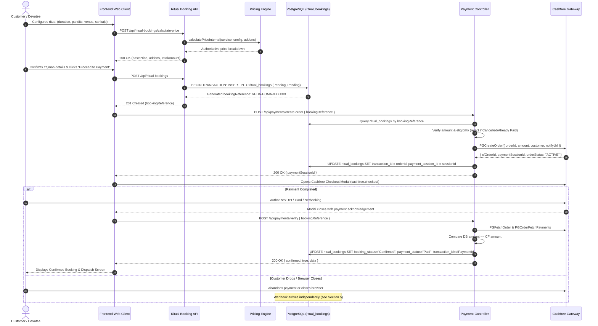
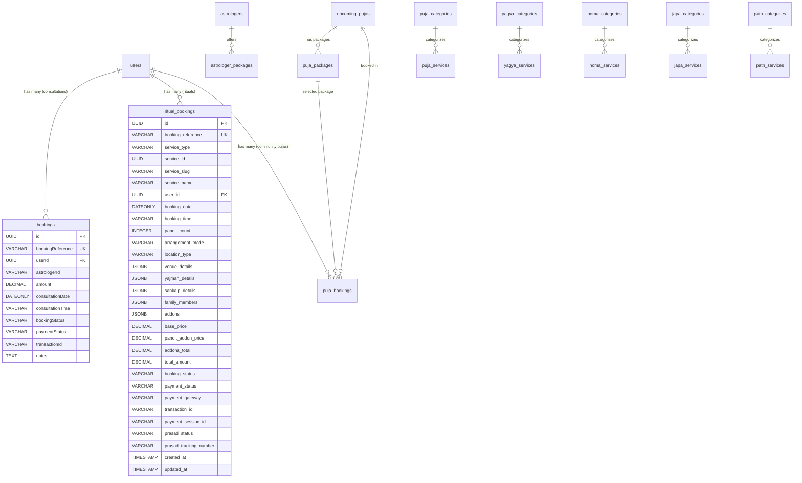
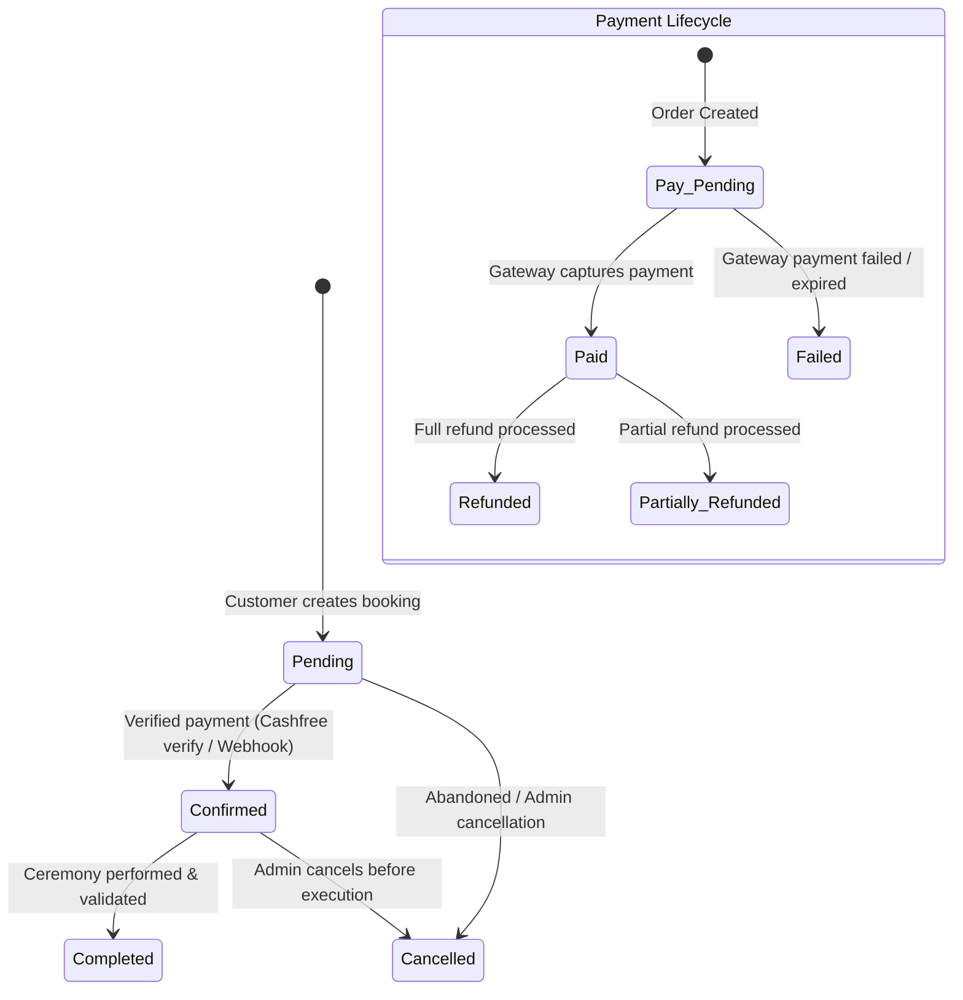

# Veda Structure: Complete Backend & Admin Booking, Orders, and Payment Architecture Audit

**Document Status:** READ-ONLY Technical & Architectural Audit  
**Audit Date:** November 06, 2026  
**Audited Targets:** `backend/`, `admin-veda-structure/`, `frontend-user1/`  
**Classification:** Internal Core Architecture Audit & Engineering Roadmap

---

## 1. Executive Summary

This audit assesses how customer bookings, service orders, Cashfree payments, retry attempts, refunds, and fulfillment tracking currently operate across the Veda Structure platform.

### Core Discoveries
1. **The "Orders" Concept Already Exists in `ritual_bookings`:**  
   There is no separate `orders` table in PostgreSQL, nor is one recommended. The `ritual_bookings` table stores every attribute of a customer service order: line-item configuration, officiating purohits (pandit count), dates/times, yajman customer details, gotra/sankalp, venue/location, authoritative itemized pricing snapshot (`basePrice`, `panditAddonPrice`, `addonsTotal`, `totalAmount`), Cashfree transaction IDs, and physical delivery status (`prasadStatus`, `prasadTrackingNumber`).
2. **The "Admin Panel" Currently Operates on a Split Reality:**  
   - The Admin panel's active `Bookings.tsx` and `BookingDetail.tsx` pages exclusively manage **Astrologer Consultations** (`bookings` table).
   - **Zero ritual bookings** (Puja, Yagya, Homa, Japa, Path) are visible, searchable, or manageable in the Admin Panel today.
   - The Admin `Orders.tsx` and `Payments.tsx` files are disconnected prototype mockups relying 100% on static in-memory dummy data (`mockData.ts`) and are not even registered in `App.tsx` routes or `Sidebar.tsx`.
   - The Admin `Dashboard.tsx` stat cards (e.g., "₹4,82,500 Revenue", "1,284 Orders") are hardcoded strings.
3. **Cashfree Payment Gateway Integration is Server-Side Authoritative but Single-Attempt:**  
   - Pricing is strictly computed and validated server-side; client-manipulated amounts are rejected.
   - HMAC-SHA256 webhook signatures are verified using raw request payloads.
   - However, payments lack an audit-trail table (`payment_attempts` or `payment_transactions`). When a customer retries a payment, or when a payment succeeds, the gateway IDs (`order_id`, `cf_payment_id`) overwrite the existing single string column `transaction_id`, discarding previous attempt history.
4. **Refund Integration Exists Only for Astrologers:**  
   - Cashfree refund issuance and verification endpoints exist strictly for the `bookings` table (consultations).
   - No refund endpoints or refund state transitions exist for `ritual_bookings`. Furthermore, `ritual_bookings` does not have a `notes` column, causing refund webhooks for ritual bookings to fail silent note logging.
5. **The Cleanest, Safest Architectural Path:**  
   Rather than introducing a redundant, breaking `orders` table that would require dual-writing across all booking wizards, the platform should:
   - Formally treat `ritual_bookings` as the canonical ritual service orders.
   - Add unified Admin endpoints for `ritual_bookings` (`GET /api/admin/ritual-bookings`, `GET /api/admin/ritual-bookings/:id`, status and fulfillment PATCH, and refund POST endpoints).
   - Introduce a lightweight `payment_transactions` table to capture all gateway payment attempts, webhooks, and refund events chronologically.
   - Upgrade the Admin UI to provide dedicated or unified views for both Ritual Ceremonies and Astrologer Consultations with real-time database-backed dashboards.

---

## 2. Complete Backend Architecture Map

```
backend/
├── src/
│   ├── app.js                          # Express app configuration & route mounting
│   ├── server.js                       # Server bootstrapper & DB connection check
│   ├── config/
│   │   ├── database.js                 # Sequelize PostgreSQL instance
│   │   └── config.cjs                  # Sequelize CLI environment configuration
│   ├── models/
│   │   ├── index.js                    # Model registry & relational associations
│   │   ├── bookingModel.js             # Astrologer consultation bookings (bookings table)
│   │   ├── ritualBookingModel.js       # Generic ceremony bookings (ritual_bookings table)
│   │   ├── pujaBookingModel.js         # Upcoming community puja bookings (puja_bookings table)
│   │   ├── userModel.js                # Customer & admin users (users table)
│   │   ├── astrologerModel.js          # Astrologer profiles
│   │   ├── astrologerPackageModel.js   # Astrologer consultation packages
│   │   ├── pujaServiceModel.js         # Puja catalogue
│   │   ├── yagyaServiceModel.js        # Yagya catalogue
│   │   ├── homaServiceModel.js         # Homa catalogue
│   │   ├── japaServiceModel.js         # Japa catalogue
│   │   └── pathServiceModel.js         # Path catalogue
│   ├── controllers/
│   │   ├── booking.controller.js       # Astrologer booking CRUD, reschedule, refund
│   │   ├── ritualBooking.controller.js # Ritual price calculation, creation, public lookup
│   │   └── payment.controller.js       # Polymorphic Cashfree order creation, verification, webhooks
│   ├── services/
│   │   ├── bookingResolver.service.js  # Polymorphic adapter bridging Booking & RitualBooking
│   │   ├── cashfree.service.js         # Cashfree PG SDK v6 integration
│   │   └── ritualPricing.service.js    # Authoritative price calculation engine
│   ├── serializers/
│   │   └── ritualBooking.serializer.js # Sanitization & response formatting
│   ├── middleware/
│   │   ├── auth.middleware.js          # authenticate, optionalAuthenticate, authorizeAdmin
│   │   └── rateLimiter.middleware.js   # Anti-abuse rate limiters
│   └── utils/
│       └── slotConcurrency.js         # PostgreSQL advisory locking for astrologer slots
```

### Core Architectural Separation
| Dimension | Astrologer Consultations | Ritual Ceremonies (Puja/Yagya/Homa/Japa/Path) | Upcoming Community Pujas |
| :--- | :--- | :--- | :--- |
| **Model** | `Booking` (`bookingModel.js`) | `RitualBooking` (`ritualBookingModel.js`) | `PujaBooking` (`pujaBookingModel.js`) |
| **Database Table** | `bookings` | `ritual_bookings` | `puja_bookings` |
| **Public Controller** | `booking.controller.js` | `ritualBooking.controller.js` | `upcomingPuja.controller.js` |
| **Admin Controller** | `booking.controller.js` (`getAllBookings`, `getAdminBookingById`) | **NONE** (Completely Missing) | `upcomingPujaAdmin.controller.js` |
| **Refund Support** | **Full** (initiate + verify via Cashfree) | **NONE** | **NONE** |
| **Payment Bridge** | `createConsultationAdapter` | `createRitualBookingAdapter` | None (Directly unlinked) |

---

## 3. Complete Admin Architecture Map

```
admin-veda-structure/
├── src/
│   ├── App.tsx                         # Router configuration (Missing: Bookings, Orders, Payments)
│   ├── components/
│   │   ├── Sidebar.tsx                 # Navigation bar (Missing: Bookings, Orders, Payments links)
│   │   ├── Header.tsx                  # Top bar with user profile & logout
│   │   └── AdminLayout.tsx             # Main dashboard shell
│   ├── pages/
│   │   ├── Dashboard.tsx               # Metric cards (Currently 100% hardcoded mock data)
│   │   ├── Bookings.tsx                # Exclusively Astrologer Consultations (/api/bookings/admin)
│   │   ├── BookingDetail.tsx           # Consultation detail, reschedule, refund
│   │   ├── Orders.tsx                  # UNROUTED prototype, imports mockData.ts
│   │   ├── Payments.tsx                # UNROUTED prototype, imports mockData.ts
│   │   ├── Astrologers.tsx             # Astrologer catalogue management
│   │   ├── PujaServices.tsx            # Puja service catalogue
│   │   ├── YagyaServices.tsx           # Yagya service catalogue
│   │   ├── HomaServices.tsx            # Homa service catalogue
│   │   ├── JapaServices.tsx            # Japa service catalogue
│   │   └── PathServices.tsx            # Path service catalogue
│   ├── services/
│   │   ├── api.ts                      # Axios instance with JWT interceptors
│   │   └── bookingAdminService.ts      # Astrologer consultation API client
│   └── data/
│       └── mockData.ts                 # Hardcoded arrays for orders, payments, mock bookings
```

### Critical Findings in Admin Panel:
1. **Unrouted Pages:** `admin-veda-structure/src/pages/Orders.tsx` and `Payments.tsx` are orphaned files. They are neither imported into `App.tsx` nor routed.
2. **Missing Sidebar Navigation:** `Sidebar.tsx` has sections for *Astrologers*, *Yagya & Puja (Catalogues)*, and *Library*, but no link to Bookings, Orders, or Payments.
3. **Misleading Nomenclature:** `Bookings.tsx` is actually "Consultation Bookings" for Vishal Bhardwaj and Acharya Anurag Bhardwaj. No ritual booking (Puja, Yagya, Homa, Japa, Path) can be accessed.
4. **Hardcoded Dashboard:** `Dashboard.tsx` displays fake revenue figures, order counts, and pie charts drawn from `mockData.ts`.

---

## 4. Booking Lifecycle Diagram



---

## 5. Payment Lifecycle Diagram (Webhooks & Retries)

```mermaid
sequenceDiagram
    autonumber
    participant CF as Cashfree Payment Gateway
    participant Webhook as POST /api/payments/webhook
    participant Resolver as Booking Resolver Adapter
    participant DB as PostgreSQL
    participant Admin as Admin Panel

    Note over CF,Webhook: Asynchronous Server-to-Server Event
    CF->>Webhook: POST /api/payments/webhook<br/>Headers: x-webhook-signature, x-webhook-timestamp
    Webhook->>Webhook: Verify HMAC-SHA256 signature using req.rawBody

    alt Signature Valid
        Webhook->>Resolver: resolveBookingEntity(order_id)
        Resolver->>DB: Lookup booking by reference (stripping retry suffix)
        
        alt Event: PAYMENT_SUCCESS_WEBHOOK or ORDER_PAID
            Webhook->>Webhook: Validate DB amount == Webhook order_amount
            alt Already Paid?
                Webhook-->>CF: 200 OK (Idempotent exit: Already confirmed)
            else Pending Payment
                Webhook->>DB: UPDATE booking SET bookingStatus="Confirmed", paymentStatus="Paid", transactionId=cfPaymentId
                Webhook-->>CF: 200 OK ("Webhook processed. Booking confirmed.")
            end
        else Event: REFUND_STATUS_WEBHOOK
            Webhook->>DB: Check cumulative refunds vs totalAmount
            Webhook->>DB: UPDATE booking SET paymentStatus="Refunded" or "Partially Refunded"
            Webhook-->>CF: 200 OK ("Refund webhook processed.")
        else Event: PAYMENT_FAILED / USER_DROPPED
            Webhook-->>CF: 200 OK (Acknowledged; status remains Pending)
        end
    else Signature Invalid
        Webhook-->>CF: 401 Unauthorized ("Invalid webhook signature.")
    end
```

---

## 6. Existing Database Schema & Relationships

### 6.1 Entity Relational Diagram



### 6.2 Key Schema Columns in `ritual_bookings`
| Column Name | SQL Type | Constraints | Description |
| :--- | :--- | :--- | :--- |
| `id` | UUID | Primary Key, default UUIDV4 | Unique database identifier |
| `booking_reference` | VARCHAR(50) | Unique, Not Null | Formatted ref (e.g. `VEDA-HOMA-XXXXXX`) |
| `service_type` | VARCHAR(30) | Enum: PUJA, YAGYA, HOMA, JAPA, PATH | Service vertical |
| `service_id` | UUID | Not Null | Foreign key to specific service record |
| `service_slug` | VARCHAR(120) | Not Null | URL slug of service |
| `service_name` | VARCHAR(255) | Not Null | Human-readable name of ceremony |
| `user_id` | UUID | Nullable | Associated registered devotee ID |
| `booking_date` | DATEONLY | Not Null | Commencement date |
| `booking_time` | VARCHAR(50) | Not Null | Commencement time slot |
| `duration_selected`| VARCHAR(50) | Not Null | Human-readable duration |
| `duration_hours` | INTEGER | Min 1 | Total duration in hours |
| `panditCount` | INTEGER | Default 1 | Number of officiating purohits |
| `arrangement_mode` | VARCHAR(40) | Enum: remote, customer_home, kashi, etc. | Location mode |
| `location_type` | VARCHAR(50) | Enum: remote, customer_home, kashi, etc. | Venue type |
| `venue_details` | JSONB | Default `{}` | Address, city, pincode, instructions |
| `yajman_details` | JSONB | Not Null | Primary devotee: name, phone, email, gotra |
| `sankalp_details`| JSONB | Not Null | Intention, deity, kula devata, metadata |
| `family_members` | JSONB | Default `[]` | Participating family names & nakshatras |
| `addons` | JSONB | Default `[]` | Selected ritual addon items & prices |
| `base_price` | DECIMAL(10,2)| Not Null | Base service dakshina |
| `pandit_addon_price`| DECIMAL(10,2)| Default 0.00 | Extra purohit fees |
| `addons_total` | DECIMAL(10,2)| Default 0.00 | Sum of selected addons |
| `total_amount` | DECIMAL(10,2)| Not Null | Authoritative total payable |
| `currency` | VARCHAR(10) | Default "INR" | Currency code |
| `booking_status` | VARCHAR(40) | Pending, Confirmed, Completed, Cancelled | Booking progress |
| `payment_status` | VARCHAR(40) | Pending, Paid, Failed, Refunded | Gateway payment state |
| `payment_gateway`| VARCHAR(40) | Default "Cashfree" | Gateway name |
| `transaction_id` | VARCHAR(100)| Nullable | Cashfree Order ID or Payment ID |
| `payment_session_id`| VARCHAR(255)| Nullable | Active Cashfree checkout session |
| `prasad_status` | VARCHAR(40) | Pending, Dispatched, Delivered | Physical dispatch status |
| `prasad_tracking_number`| VARCHAR(100)| Nullable | Shipping courier tracking ID |

---

## 7. Existing API Endpoint Inventory

| Endpoint | Method | Auth / Protection | Controller Action | Description |
| :--- | :---: | :--- | :--- | :--- |
| `/api/ritual-bookings/calculate-price` | `POST` | `optionalAuthenticate` | `calculateRitualPrice` | Validates configuration and returns authoritative itemized price |
| `/api/ritual-bookings` | `POST` | `optionalAuthenticate` | `createRitualBooking` | Validates details and creates pending record in DB transaction |
| `/api/ritual-bookings/:bookingReference` | `GET` | `optionalAuthenticate` | `getRitualBookingByReference` | Customer/public sanitized booking status lookup |
| `/api/payments/create-order` | `POST` | `paymentInitiationLimiter`, `optionalAuthenticate` | `createPaymentOrder` | Initiates or recovers Cashfree order using DB authoritative price |
| `/api/payments/verify` | `POST` | `optionalAuthenticate` | `verifyPayment` | Server-side verification with Cashfree gateway after checkout |
| `/api/payments/booking-status/:ref` | `GET` | `optionalAuthenticate` | `getPaymentBookingStatus` | Safe state recovery for frontend page reloads |
| `/api/payments/webhook` | `POST` | Signature Check (HMAC-SHA256) | `handleCashfreeWebhook` | Asynchronous server-to-server gateway notifications |
| `/api/bookings` | `POST` | `optionalAuthenticate` | `createBooking` | Creates astrologer consultation booking |
| `/api/bookings/my-bookings` | `GET` | `authenticate` | `getMyBookings` | Returns logged-in user's consultation bookings |
| `/api/bookings/admin` | `GET` | `authenticate`, `authorizeAdmin` | `getAllBookings` | **Admin listing (ONLY Astrologer Consultations)** |
| `/api/bookings/admin/:id` | `GET` | `authenticate`, `authorizeAdmin` | `getAdminBookingById` | **Admin detail (ONLY Astrologer Consultations)** |
| `/api/bookings/admin/:id/status` | `PATCH` | `authenticate`, `authorizeAdmin` | `updateBookingStatus` | Updates consultation booking status |
| `/api/bookings/admin/:id/reschedule`| `PATCH` | `authenticate`, `authorizeAdmin` | `rescheduleBooking` | Reschedules consultation slot with advisory lock |
| `/api/bookings/admin/:id/initiate-refund`| `POST` | `authenticate`, `authorizeAdmin` | `initiateBookingRefund` | Issues refund via Cashfree for consultations |
| `/api/bookings/admin/:id/verify-refund`| `POST` | `authenticate`, `authorizeAdmin` | `verifyBookingRefund` | Checks refund status with Cashfree for consultations |
| `/api/bookings/:identifier` | `GET` | `bookingLookupLimiter`, `optionalAuthenticate` | `getBookingByReferenceOrId` | Public lookup for astrologer consultations |

---

## 8. Status Matrix & Transitions

### 8.1 Current Status Fields by Entity
```
+---------------------------------------------------------------------------------------------------------+
| ENTITY           | FIELD          | VALID ENUM VALUES (SCHEMA)                                         |
+---------------------------------------------------------------------------------------------------------+
| ritual_bookings  | bookingStatus  | Pending, Confirmed, Completed, Cancelled                            |
|                  | paymentStatus  | Pending, Paid, Failed, Refunded                                     |
|                  | prasadStatus   | Pending, Dispatched, Delivered                                      |
+---------------------------------------------------------------------------------------------------------+
| bookings         | bookingStatus  | Pending, Confirmed, Completed, Cancelled, Rescheduled,               |
| (Consultations)  |                | Payment Review Required                                             |
|                  | paymentStatus  | Pending, Paid, Failed, Refunded, Refund Pending,                    |
|                  |                | Refund Failed, Refund In Progress, Partially Refunded               |
+---------------------------------------------------------------------------------------------------------+
```

### 8.2 Lifecycle State Transitions (Ritual Bookings)


### 8.3 State Transition Inconsistencies & Vulnerabilities
1. **Model Validation Crash on Partial Refund:**  
   `ritualBookingModel.js` restricts `paymentStatus` with `isIn: [["Pending", "Paid", "Failed", "Refunded"]]`.  
   However, `payment.controller.js` line 850 sets `targetPaymentStatus = "Partially Refunded"`, `"Refund Pending"`, or `"Refund Failed"` when a refund webhook fires. If Cashfree sends a partial refund webhook for a ritual, Sequelize will throw a `SequelizeValidationError` because `"Partially Refunded"` is not in the allowed array.
2. **Missing Notes Column in `ritual_bookings`:**  
   In `payment.controller.js` lines 852 and 859, the webhook handler attempts to write audit strings to `booking.notes` (e.g. `[WEBHOOK REFUND CONFIRMED] ...`). In `ritual_bookings`, there is NO `notes` column. This causes property assignment to an unmapped field, leaving no record of the refund transaction.
3. **Premature Confirmation Guard:**  
   In the public workflow, bookings can **never** become `Confirmed` before verified payment. Creation strictly defaults to `Pending`. Only `markConfirmed` in `payment.controller.js` (guarded by amount comparison against Cashfree) transitions it to `Confirmed`. However, for Astrologer bookings, an Admin can manually patch `bookingStatus = "Confirmed"` via `updateBookingStatus` even if `paymentStatus === "Pending"`.

---

## 9. Current Working Functionality

The following workflows are verified operational in source code:
- **Authoritative Price Calculation:** Endpoints calculate exact prices from database pricing records for Puja, Yagya, Homa, Japa, and Path, including extra pandits, duration days, daily chanting quotas, and addons.
- **Transactional Booking Creation:** Bookings are created in PostgreSQL with unique uppercase reference codes (`VEDA-PUJA-XXXXXXXX`, `VEDA-HOMA-XXXXXXXX`, etc.).
- **Polymorphic Booking Resolver:** `bookingResolver.service.js` parses incoming booking references and dynamically generates adapters for consultations or ritual bookings.
- **Server-Side Gateway Order Creation:** `createPaymentOrder` enforces DB amount validation, idempotency, session reuse, and retry suffixes (`${ref}_${timestamp}`) to prevent gateway duplicate collisions.
- **Real-Time Payment Verification:** `verifyPayment` queries Cashfree's `/orders/{order_id}` and `/orders/{order_id}/payments` to verify actual gateway state and amount equality before confirming.
- **Secure Webhook Verification:** `handleCashfreeWebhook` validates HMAC-SHA256 signatures using raw request bodies and handles out-of-order execution gracefully.
- **Consultation Admin Management:** Astrologer consultations can be viewed, rescheduled, cancelled, and refunded through the Admin Panel.

---

## 10. Missing Functionality

The following critical capabilities are currently missing:
1. **Admin Ritual Bookings Dashboard:** No admin list or detail views exist for Puja, Yagya, Homa, Japa, or Path. Administrators cannot see which customer booked which ritual.
2. **Admin Ritual Actions:** Administrators cannot mark a ritual booking as "Completed", cancel it, or update its operational notes.
3. **Prasad Dispatch Tracking Management:** There is no Admin UI to update `prasadStatus` (`Pending` -> `Dispatched` -> `Delivered`) or enter the `prasadTrackingNumber` courier ID.
4. **Ritual Booking Refunds:** No backend endpoints or Admin UI exist to issue Cashfree refunds for ritual bookings.
5. **Multi-Attempt Payment History:** Past payment attempts, failures, and gateway session histories are overwritten rather than logged in a dedicated table.
6. **Live Dashboard Analytics:** The Admin Dashboard displays hardcoded numbers rather than querying actual revenue, booking counts, or customer statistics from PostgreSQL.
7. **Offline / Manual Payment Support:** There is no sanctioned mechanism for an administrator to record cash, bank transfer, or temple-counter payments for rituals.

---

## 11. Critical Bugs and Security Risks

### Bug 1: Missing `notes` Column on `ritual_bookings` (Severity: HIGH)
- **Location:** `backend/src/models/ritualBookingModel.js` and `backend/src/controllers/payment.controller.js:852`
- **Impact:** Webhook handlers for refunds attempt to execute `await booking.update({ notes: ... })`. Because `notes` does not exist in `ritual_bookings`, Sequelize silently drops the field or throws depending on strictness. Furthermore, administrators cannot leave operational notes for ceremonies.

### Bug 2: `paymentStatus` Enum Mismatch in `ritualBookingModel.js` (Severity: HIGH)
- **Location:** `backend/src/models/ritualBookingModel.js:194`
- **Validation:** `isIn: [["Pending", "Paid", "Failed", "Refunded"]]`
- **Impact:** `payment.controller.js` attempts to set `"Partially Refunded"`, `"Refund Pending"`, or `"Refund Failed"`. Any refund webhook containing these statuses triggers a validation exception and returns 500 to Cashfree.

### Bug 3: Disconnected Admin Orders & Payments Pages (Severity: MEDIUM)
- **Location:** `admin-veda-structure/src/pages/Orders.tsx`, `Payments.tsx`
- **Impact:** These files are unrouted mockups importing `mockData.ts`. If an administrator navigates to them, they see simulated data with no connection to actual business operations.

### Bug 4: Single-Slot Advisory Lock Scope (Severity: LOW-MEDIUM)
- **Location:** `backend/src/controllers/payment.controller.js:605`
- **Impact:** Slot concurrency locking is implemented only for Astrologer consultations (`Booking`). Generic ritual bookings (`RitualBooking`) do not check pandit/date concurrency or enforce venue availability locks.

---

## 12. Dashboard Data Source Verification

| Dashboard Component | Rendered Value | Source in Code | Verified Status |
| :--- | :--- | :--- | :--- |
| **Total Revenue Card** | `₹4,82,500 (+12.5%)` | `admin-veda-structure/src/pages/Dashboard.tsx:32` | **HARDCODED STRING** |
| **Total Orders Card** | `1,284 (+8.2%)` | `Dashboard.tsx:33` | **HARDCODED STRING** |
| **Total Customers Card** | `8,420 (+15.3%)` | `Dashboard.tsx:34` | **HARDCODED STRING** |
| **Total Bookings Card** | `356 (+5.7%)` | `Dashboard.tsx:35` | **HARDCODED STRING** |
| **Revenue Chart** | Graphical trend lines | `Dashboard.tsx:21` -> `revenueData[filter]` from `mockData.ts` | **HARDCODED MOCK DATA** |
| **Booking Distribution** | Pie Chart | `Dashboard.tsx:129` -> `bookingTypeData` from `mockData.ts` | **HARDCODED MOCK DATA** |
| **Upcoming Bookings Table**| 5 Consultation rows | `Dashboard.tsx:225` -> `bookings` from `mockData.ts` | **HARDCODED MOCK DATA** |

**Conclusion:** The Admin Dashboard is currently 100% cosmetic and does not reflect actual database records.

---

## 13. Recommended Target Architecture

### Decision on "Orders" vs "Bookings":
**Do not create a separate `orders` table.**  
A dedicated `orders` table would duplicate 90% of the attributes already present in `ritual_bookings` (amount, customer, dates, service ID, add-ons, status). Maintaining two synchronised records during a checkout flow creates race conditions, database deadlocks, and inconsistent statuses.

Instead, implement a **Clean 3-Tier Model**:
1. **Canonical Orders / Bookings (`ritual_bookings` & `bookings`):**  
   Represent the high-level customer transaction and service agreement.
2. **Payment Transactions & Attempts (`payment_transactions` - Recommended New Table):**  
   A dedicated audit table that stores every individual payment session, gateway attempt, transaction status, webhook payload, and refund record linked by `bookingReference`.
3. **Unified Admin Management Layer:**  
   A unified Admin interface that displays both Ritual Orders and Consultation Bookings under a coherent "Orders & Bookings" module.

```
+-----------------------------------------------------------------------------------------+
|                                    CUSTOMER CHECKOUT                                    |
+-----------------------------------------------------------------------------------------+
                                             |
                                             v
                             +-------------------------------+
                             |        ritual_bookings        |  <--- Canonical Order Record
                             |   (Puja/Yagya/Homa/Japa/Path) |
                             +-------------------------------+
                                             |
                                             | 1 : N
                                             v
                             +-------------------------------+
                             |     payment_transactions      |  <--- Payment Attempts &
                             |  (Cashfree Sessions, Refunds) |       Gateway Audit Trail
                             +-------------------------------+
                                             ^
                                             |
+-----------------------------------------------------------------------------------------+
|                                 ADMIN OPERATIONS PANEL                                  |
|   - View Customer Details (Yajman, Sankalp, Venue)                                      |
|   - Inspect Payment Status & Cashfree IDs                                               |
|   - Update Fulfillment (Prasad Dispatch, Tracking Number)                               |
|   - Issue Refunds via Cashfree                                                          |
|   - Live Database Analytics                                                             |
+-----------------------------------------------------------------------------------------+
```

---

## 14. Exact Files Requiring Modification (Phase Roadmap)

### Backend Files
1. `backend/src/models/ritualBookingModel.js`:  
   - Add `notes` (TEXT, nullable).
   - Expand `paymentStatus` enum validation to include `"Partially Refunded"`, `"Refund Pending"`, `"Refund Failed"`, `"Refund In Progress"`.
2. `backend/migrations/YYYYMMDDHHMMSS-add-notes-and-statuses-to-ritual-bookings.cjs`:  
   - Database migration adding `notes` column to `ritual_bookings`.
3. `backend/src/controllers/ritualBookingAdmin.controller.js` *(New File)*:  
   - `getAllRitualBookings` (filtering by `serviceType`, `bookingStatus`, `paymentStatus`, date, search).
   - `getAdminRitualBookingById` (full customer, sankalp, venue, and payment breakdown).
   - `updateRitualBookingStatus` (Confirmed, Completed, Cancelled).
   - `updateRitualFulfillment` (Prasad status and tracking number).
   - `initiateRitualRefund` (Cashfree refund integration).
   - `verifyRitualRefund` (Cashfree refund verification).
4. `backend/src/routes/ritualBookingAdmin.routes.js` *(New File)*:  
   - Protected admin routes for the above controller actions.
5. `backend/src/app.js`:  
   - Mount `/api/admin/ritual-bookings` route.
6. `backend/src/controllers/dashboardAdmin.controller.js` *(New File)*:  
   - Real-time aggregation endpoints for revenue, booking counts, and upcoming schedules.

### Admin Panel Files
1. `admin-veda-structure/src/App.tsx`:  
   - Register `/admin/bookings` and `/admin/bookings/:id`.
   - Register `/admin/rituals` or unify into `/admin/orders`.
2. `admin-veda-structure/src/components/Sidebar.tsx`:  
   - Add top-level navigation item: **"Bookings & Orders"** (with sub-items: *Ritual Orders* and *Consultations*).
3. `admin-veda-structure/src/services/ritualBookingAdminService.ts` *(New File)*:  
   - API client for ritual booking admin endpoints.
4. `admin-veda-structure/src/pages/RitualBookings.tsx` *(New File)*:  
   - Data table displaying ritual orders with filters for Service Type (Puja, Yagya, Homa, Japa, Path), Payment Status, Booking Status, and Date.
5. `admin-veda-structure/src/pages/RitualBookingDetail.tsx` *(New File)*:  
   - Detailed view showing Devotee details, Gotra, Sankalp intention, Officiating purohits, Venue address, Price breakdown, Cashfree IDs, Prasad dispatch form, and Refund controls.
6. `admin-veda-structure/src/pages/Dashboard.tsx`:  
   - Replace static numbers with `useEffect` fetch to backend dashboard aggregation endpoint.

---

## 15. Database Migration Requirements

A single, non-destructive migration is required for the baseline fix:

```javascript
// migrations/20261106100000-add-notes-to-ritual-bookings.cjs
module.exports = {
  up: async (queryInterface, Sequelize) => {
    await queryInterface.addColumn('ritual_bookings', 'notes', {
      type: Sequelize.TEXT,
      allowNull: true,
    });
  },
  down: async (queryInterface) => {
    await queryInterface.removeColumn('ritual_bookings', 'notes');
  }
};
```

*(Optional Future Enhancement):* A second migration creating `payment_transactions` to store multi-attempt payment histories.

---

## 16. API Changes Required

### New Admin Endpoints for Ritual Orders
| HTTP Method | Route | Description |
| :--- | :--- | :--- |
| `GET` | `/api/admin/ritual-bookings` | Paginated, filterable catalogue of all Puja, Yagya, Homa, Japa, and Path bookings |
| `GET` | `/api/admin/ritual-bookings/:id` | Full operational detail view (Yajman, Sankalp, Addons, Venue, Payment) |
| `PATCH` | `/api/admin/ritual-bookings/:id/status` | Update booking status (`Confirmed`, `Completed`, `Cancelled`) and append admin notes |
| `PATCH` | `/api/admin/ritual-bookings/:id/fulfillment`| Update Prasad dispatch state (`Dispatched`, `Delivered`) and tracking number |
| `POST` | `/api/admin/ritual-bookings/:id/initiate-refund`| Trigger order refund through Cashfree API |
| `POST` | `/api/admin/ritual-bookings/:id/verify-refund` | Verify refund status with Cashfree |
| `GET` | `/api/admin/dashboard/metrics` | Live revenue, booking counts, and upcoming ceremony metrics |

---

## 17. Admin UI Implementation Plan

### Step 1: Sidebar & Navigation Restructure
Add a dedicated "Commerce / Bookings" section in `Sidebar.tsx`:
- **Ritual Ceremonies** (`/admin/ritual-bookings`): All Puja, Yagya, Homa, Japa, and Path orders.
- **Consultations** (`/admin/bookings`): Astrologer appointments.
- **Transactions & Refunds** (`/admin/payments`): Connected to live payment data.

### Step 2: Ritual Orders Listing Page (`RitualBookings.tsx`)
- Metric summary cards: *Total Orders*, *Paid / Confirmed*, *Awaiting Payment*, *Prasad Pending Dispatch*.
- Search bar filtering by Booking Reference, Devotee Name, Phone, and Service Name.
- Filter dropdowns:
  - **Service Vertical:** All, Puja, Yagya, Homa, Japa, Path.
  - **Payment Status:** All, Paid, Pending, Failed, Refunded.
  - **Booking Status:** All, Confirmed, Pending, Completed, Cancelled.
  - **Prasad Status:** All, Pending, Dispatched, Delivered.
- Action menu: View Details, Mark Completed, Dispatch Prasad.

### Step 3: Ritual Order Detail Page (`RitualBookingDetail.tsx`)
- **Header:** Reference code badge, booking date/time, service badge, payment status, and booking status.
- **Devotee & Sankalp Card:** Primary Yajman name, phone, email, Gotra, Rashi, Nakshatra, and Sankalp intention text.
- **Ceremony Configuration Card:** Duration, pandit count, venue details, arrangement mode (Kashi, Home, Remote).
- **Financial & Payment Card:** Base dakshina, purohit fees, addon breakdown, total payable, Cashfree Order ID, Cashfree Payment ID, and Gateway Status.
- **Prasad & Sacred Dispatch Form:** Editable tracking number, courier partner selector, and dispatch status toggle.
- **Refund Initiation Modal:** Safe refund form with idempotency key, amount validation, and Cashfree status verification.

---

## 18. Comprehensive Test Plan

### Test Scenarios to Verify:
1. **Booking Lifecycle:**
   - Devotee configures Homa -> price calculated -> booking created (`Pending`) -> Cashfree order created (`ACTIVE`).
2. **Successful Payment Flow:**
   - Devotee pays in Cashfree modal -> server verifies payment -> DB transitions to `Confirmed` and `Paid`.
3. **Webhook Verification & Idempotency:**
   - Webhook arrives before client verification -> marks `Confirmed`. Subsequent client call returns `200 Already Verified`.
   - Repeated webhook delivery -> returns `200 Acknowledged` without mutating or erroring.
4. **Retry Protection:**
   - Customer opens payment modal, closes without paying, and clicks "Pay Now" again. System generates retry suffix (`${ref}_123456`) and recovers or creates a fresh session without duplicate booking records.
5. **Admin Operations:**
   - Administrator searches by reference -> views full devotee Gotra and Sankalp.
   - Administrator enters Prasad tracking number -> saved in PostgreSQL.
   - Administrator issues refund -> Cashfree initiates refund -> status updates to `Refund Pending` / `Refunded`.

---

## 19. Prioritized Implementation Roadmap

| Phase | Title | Scope | Impact |
| :---: | :--- | :--- | :--- |
| **Phase 1** | **Backend Schema & Admin API** | Add `notes` to `ritual_bookings`, fix enum validation, create `ritualBookingAdmin.controller.js` and routes | High: Unlocks backend capability for Admin visibility |
| **Phase 2** | **Admin Ritual Orders UI** | Build `RitualBookings.tsx` and `RitualBookingDetail.tsx`, update `Sidebar.tsx` and `App.tsx` | High: Fulfills client's primary requirement to see customer orders |
| **Phase 3** | **Prasad Fulfillment & Tracking** | Implement Prasad tracking forms in Admin and devotee dispatch status screens | Medium: Operational logistics |
| **Phase 4** | **Ritual Refund Integration** | Connect `initiateCashfreeRefund` to ritual bookings in backend and Admin UI | Medium: Financial operations |
| **Phase 5** | **Live Dashboard & Analytics** | Replace mock data in `Dashboard.tsx` with live database aggregation endpoints | Low-Medium: Executive reporting |
| **Phase 6** | **Payment Attempts Audit Table** | Create `payment_transactions` table for multi-attempt audit logs | Low: Long-term auditability |

