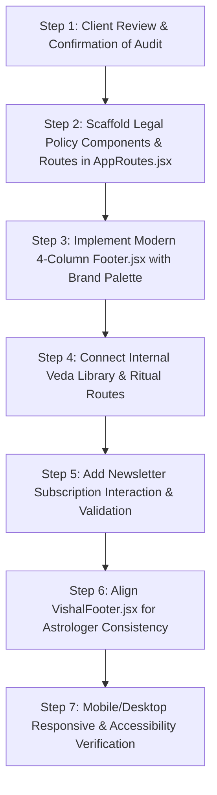

# VEDA STRUCTURE: FOOTER REDESIGN — PHASE 1 COMPLETE CODE & UI/UX AUDIT REPORT

**Date:** November 25, 2026  
**Auditor:** Antigravity AI Engineer  
**Scope:** `frontend-user1` (React + Vite + Tailwind CSS) & `backend` (Node.js/Express)  
**Audit Mode:** STRICT READ-ONLY AUDIT (Zero code, route, or database modifications)

---

## EXECUTIVE SUMMARY

A comprehensive forensic audit of the Veda Structure website footer reveals that the current implementation suffers from severe visual bloat, excessive vertical height (>750px on desktop, >1,800px on mobile), duplicative navigation items, and a critical **40.7% broken link rate** where 11 out of 27 links point to non-existent routes that immediately trigger the `NotFound (404)` page.

Furthermore, navigation links for core resources like the **Veda Library** point to external staging URLs (`https://veda-library-five.vercel.app/library`) despite the entire Library engine already being compiled internally within `frontend-user1` at `/library`. Similarly, placeholder contact info (`+91 98765 43210`) and unbacked newsletter functionality represent major credibility risks for an authentic Vedic platform.

This report documents the current architecture, audits every link, evaluates responsive UI issues, reviews backend capabilities, and presents an actionable, modern 4-column structure inspired by the clean VedaLearn reference layout.

---

## 1. CURRENT FOOTER ARCHITECTURE

### 1.1 File Locations & Layouts
The public-facing user application contains two footer components:

1. **Canonical Website Footer:**
   - **File Path:** [`frontend-user1/src/components/layout/Footer.jsx`](file:///c:/Users/shiva/Desktop/FreeLance_veda/frontend-user1/src/components/layout/Footer.jsx) (369 lines)
   - **Mounted Layouts:**
     - [`frontend-user1/src/components/layout/MainLayout.jsx`](file:///c:/Users/shiva/Desktop/FreeLance_veda/frontend-user1/src/components/layout/MainLayout.jsx) (L27): Wraps the root homepage (`/`), Community (`/community`), Astrologer directory (`/astrologers`), Upcoming Pujas (`/puja`), and Consultations (`/book-consultation`).
     - [`frontend-user1/src/layouts/YagyaPujaLayout.jsx`](file:///c:/Users/shiva/Desktop/FreeLance_veda/frontend-user1/src/layouts/YagyaPujaLayout.jsx) (L19): Wraps all dedicated ritual routes (`/yagya-puja/*`, including Puja, Yagya, Japa, Path, and Homa catalogues and detail pages).

2. **Specialized Astrologer Footer:**
   - **File Path:** [`frontend-user1/src/components/layout/VishalFooter.jsx`](file:///c:/Users/shiva/Desktop/FreeLance_veda/frontend-user1/src/components/layout/VishalFooter.jsx) (170 lines)
   - **Mounted Layout:** [`frontend-user1/src/layouts/VishalLayout.jsx`](file:///c:/Users/shiva/Desktop/FreeLance_veda/frontend-user1/src/layouts/VishalLayout.jsx) (L18): Exclusively serves astrologer profile routes (`/astrologers/vishal-bhardwaj/*`, `/astrologers/acharya-anurag-bhardwaj/*`).

### 1.2 Subcomponent Breakdown of `Footer.jsx`
The existing `Footer.jsx` is divided into 4 stacked sections:
- **Section 1: Sacred Shloka & Trust Promises Ribbon (L24–82):**
  - Shloka heading: *“ॐ असतो मा सद्गमय । तमसो मा ज्योतिर्गमय । मृत्योर्मा अमृतं गमय ॥”*
  - 4 trust pillars: *100% Vedic Authentic*, *Worldwide Delivery*, *Verified Acharyas*, *Sacred Packaging*.
- **Section 2: Brand Identity & Contact Card (L89–232):**
  - Veda Structure logo & wordmark.
  - Value proposition paragraph.
  - Contact box (Support email, placeholder WhatsApp phone, Kashi address).
  - 5 Social media icon buttons (Instagram, YouTube, Facebook, X, WhatsApp).
- **Section 3: Navigation Grid (L234–334):**
  - Sub-Column 1: `SACRED RITUALS` (6 links).
  - Sub-Column 2: `RESOURCES` (6 links).
  - Sub-Column 3: `CUSTOMER CARE` (6 links).
- **Section 4: Bottom Legal & Copyright Bar (L338–366):**
  - Copyright statement (`© 2026 Veda Structure`).
  - 4 inline legal links (`Privacy Policy`, `Terms & Conditions`, `Shipping Policy`, `Refunds & Cancellations`).
  - Brand tagline (`Sanatan Dharma Sanctuary · Varanasi`).

---

## 2. COMPLETE EXISTING LINK INVENTORY TABLE

Every single link currently rendered in `Footer.jsx` was audited against [`frontend-user1/src/routes/AppRoutes.jsx`](file:///c:/Users/shiva/Desktop/FreeLance_veda/frontend-user1/src/routes/AppRoutes.jsx) and the physical codebase:

| # | Current Item Label | Current Destination (`to` / `href`) | Destination Exists? | Duplicate? | Code / Route Status | Recommendation |
|---|---|---|---|---|---|---|
| 1 | **Brand Logo / Name** | `/` | **YES** | No | Resolves to `Home.jsx` (L118) | **Retain** as canonical home link in Brand column. |
| 2 | **Support Email** | `mailto:support@vedastructure.com` | **YES** | No | Protocol handler opens email client | **Retain** in Help & Support column. |
| 3 | **WhatsApp & Support** | `https://wa.me/919876543210` | **NO (Dummy)** | Yes (redundant w/ social WhatsApp) | External URL with fake placeholder phone number | **Update** with verified business number or replace with direct contact modal. |
| 4 | **Instagram** | `https://instagram.com` | **NO (Generic)** | No | External root homepage, not brand page | **Update** with actual verified handle URL (e.g. `@vedastructure`). |
| 5 | **YouTube** | `https://youtube.com` | **NO (Generic)** | No | External root homepage, not brand channel | **Update** with actual verified channel URL. |
| 6 | **Facebook** | `https://facebook.com` | **NO (Generic)** | No | External root homepage, not brand page | **Update** with actual verified page URL. |
| 7 | **X (Twitter)** | `https://x.com` | **NO (Generic)** | No | External root homepage, not brand account | **Update** with actual verified handle URL. |
| 8 | **WhatsApp Icon** | `https://whatsapp.com` | **NO (Generic)** | Yes (duplicates item #3) | External generic web link | **Consolidate** into single direct WhatsApp support action. |
| 9 | **Puja Ceremonies** | `/yagya-puja/puja` | **YES** | No | Resolves to `PujaCatalogueListing.jsx` (L80) | **Retain** under Quick Links. |
| 10 | **Vedic Yagya** | `/yagya-puja/yagya` | **YES** | No | Resolves to `YagyaCatalogueListing.jsx` (L85) | **Retain** under Quick Links. |
| 11 | **Japa Anushthana** | `/yagya-puja/japa` | **YES** | No | Resolves to `JapaCatalogueListing.jsx` (L91) | **Retain** under Quick Links. |
| 12 | **Shastric Path** | `/yagya-puja/path` | **YES** | No | Resolves to `PathCatalogueListing.jsx` (L98) | **Retain** under Quick Links. |
| 13 | **Vedic Homa & Havan** | `/yagya-puja/homa` | **YES** | No | Resolves to `HomaCatalogueListing.jsx` (L104) | **Retain** under Quick Links. |
| 14 | **All Sacred Services** | `/yagya-puja` | **YES** | Mild (overlaps with #9-#13) | Resolves to `YagyaPujaLanding.jsx` (L79) | **Retain** as "All Sacred Rituals" overview. |
| 15 | **Sacred Shop** | `/shop` | **CRITICAL 404** | No | **Route does NOT exist in AppRoutes.jsx** | **Remove** until Shop module is built. |
| 16 | **Temple Prasadam** | `/prasad` | **CRITICAL 404** | No | **Route does NOT exist in AppRoutes.jsx** | **Remove** until Prasadam module is built. |
| 17 | **Vedic Courses** | `/courses` | **CRITICAL 404** | No | **Route does NOT exist in AppRoutes.jsx** | **Remove** until LMS/Courses module is built. |
| 18 | **Upcoming Puja** | `/puja/upcoming` | **YES** | Partial (overlaps with #9 Puja) | Resolves to `PujaListing.jsx` (L138) | **Retain** under Quick Links. |
| 19 | **Book Consultation** | `/book-consultation` | **YES** | No | Resolves to `Consultation.jsx` (L134) | **Retain** under Quick Links. |
| 20 | **Veda Library** | `https://veda-library-five.vercel.app/library` | **EXTERNAL** | No | External staging Vercel URL | **Switch to internal** `<Link to="/library">`. |
| 21 | **Contact Us** | `/contact` | **CRITICAL 404** | Duplicate info in col 1 | **Route does NOT exist in AppRoutes.jsx** | **Implement** `/contact` route or trigger contact modal. |
| 22 | **Common FAQs** | `/faqs` | **CRITICAL 404** | No | **Route does NOT exist in AppRoutes.jsx** | **Implement** `/faqs` route or link to contextual FAQ section. |
| 23 | **My Bookings** | `/bookings` | **CRITICAL 404** | No | **Route does NOT exist in AppRoutes.jsx** | **Implement** user dashboard or route to login/account. |
| 24 | **My Orders** | `/orders` | **CRITICAL 404** | No | **Route does NOT exist in AppRoutes.jsx** | **Remove** until order tracking is built. |
| 25 | **Shipping & Delivery** | `/shipping` | **CRITICAL 404** | Yes (duplicates bottom bar #28) | **Route does NOT exist in AppRoutes.jsx** | **Consolidate** into bottom legal bar. |
| 26 | **Returns & Refunds** | `/returns` | **CRITICAL 404** | Yes (duplicates bottom bar #29) | **Route does NOT exist in AppRoutes.jsx** | **Consolidate** into bottom legal bar. |
| 27 | **Privacy Policy** | `/privacy` | **CRITICAL 404** | No | **Route does NOT exist in AppRoutes.jsx** | **Implement** `/privacy` page or policy modal. |
| 28 | **Terms & Conditions** | `/terms` | **CRITICAL 404** | No | **Route does NOT exist in AppRoutes.jsx** | **Implement** `/terms` page or policy modal. |
| 29 | **Shipping Policy** | `/shipping` | **CRITICAL 404** | Yes (duplicates #25) | **Route does NOT exist in AppRoutes.jsx** | **Implement** `/shipping` or unified policy modal. |
| 30 | **Refunds & Cancellations** | `/returns` | **CRITICAL 404** | Yes (duplicates #26) | **Route does NOT exist in AppRoutes.jsx** | **Implement** `/returns` or unified policy modal. |

---

## 3. DUPLICATE AND UNNECESSARY CONTENT ANALYSIS

### 3.1 Direct Duplication
1. **Shipping & Delivery vs Shipping Policy:**
   - Appears in Column 3 (`/shipping`) AND in the bottom legal bar (`/shipping`).
   - Both links 404, compounding user frustration.
2. **Returns & Refunds vs Refunds & Cancellations:**
   - Appears in Column 3 (`/returns`) AND in the bottom legal bar (`/returns`).
   - Both links 404.
3. **WhatsApp Communication:**
   - Rendered as a verified contact item with a phone link, AND as an isolated social icon button in the same block.

### 3.2 Phantom / Ghost Services (Unbuilt Modules)
The current footer advertises features that do not exist in the code:
- `/shop` (Sacred Shop) — No ecommerce store, product catalog, or cart exists in `frontend-user1`.
- `/prasad` (Temple Prasadam) — No independent prasad ordering system exists outside ritual booking add-ons.
- `/courses` (Vedic Courses) — No learning management system or course viewer exists.
- `/orders` (My Orders) — No order tracking portal exists.
- `/bookings` (My Bookings) — While backend APIs exist for admin unified bookings, there is currently NO end-user customer booking dashboard page in `frontend-user1`.

*Promoting non-existent services undermines trust for high-value sacred ceremonies ($200–$2,500).*

---

## 4. ROUTE VERIFICATION RESULTS (`AppRoutes.jsx`)

An inspection of `AppRoutes.jsx` (L1–171) proves the exact route mapping:

```
Total Defined Routes in AppRoutes.jsx: 48
Working Footer Targets:
  ✓ /                          (Home.jsx)
  ✓ /yagya-puja/puja           (PujaCatalogueListing.jsx)
  ✓ /yagya-puja/yagya          (YagyaCatalogueListing.jsx)
  ✓ /yagya-puja/japa           (JapaCatalogueListing.jsx)
  ✓ /yagya-puja/path           (PathCatalogueListing.jsx)
  ✓ /yagya-puja/homa           (HomaCatalogueListing.jsx)
  ✓ /yagya-puja                (YagyaPujaLanding.jsx)
  ✓ /puja/upcoming             (PujaListing.jsx)
  ✓ /book-consultation         (Consultation.jsx)
  ✓ /library                   (LibraryPage.jsx) [Locally available, but footer used external URL!]

Missing / 404 Footer Targets:
  ✗ /shop                      (No route -> NotFound.jsx)
  ✗ /prasad                    (No route -> NotFound.jsx)
  ✗ /courses                   (No route -> NotFound.jsx)
  ✗ /contact                   (No route -> NotFound.jsx)
  ✗ /faqs                      (No route -> NotFound.jsx)
  ✗ /bookings                  (No route -> NotFound.jsx)
  ✗ /orders                    (No route -> NotFound.jsx)
  ✗ /shipping                  (No route -> NotFound.jsx)
  ✗ /returns                   (No route -> NotFound.jsx)
  ✗ /privacy                   (No route -> NotFound.jsx)
  ✗ /terms                     (No route -> NotFound.jsx)
```

**Conclusion:** 11 links in the footer immediately trigger the catch-all `NotFound` component (L165).

---

## 5. VEDA PUJA AND LIBRARY NAVIGATION FINDINGS

### 5.1 Veda Library Architecture
- **Current Footer Link:** `<a href="https://veda-library-five.vercel.app/library" target="_blank" rel="noopener noreferrer">`
- **Current Navbar Link:** `<a href="https://library.vedastructure.com/">`
- **Codebase Reality:** The Veda Library is **fully integrated inside `frontend-user1`** under `src/library/`:
  - `LibraryPage.jsx` mounted at `/library` and `/veda-library`
  - `LibraryTreePage.jsx` mounted at `/library/tree`
  - `LibraryTopicPage.jsx` mounted at `/library/:topicSlug`
  - Full API integration with backend endpoints: `/api/library/vedas`, `/api/library/puranas`, `/api/library/upanishads`, etc.
- **Finding:** Linking out to `veda-library-five.vercel.app` leaks traffic away from the main application to a third-party development deployment. Users lose their session and state.
- **Recommendation:** Replace with internal client-side navigation: `<Link to="/library">Veda Library</Link>`.

### 5.2 Veda Puja & Ritual Booking Navigation
- **Architecture:** All 5 ritual services (`puja`, `yagya`, `japa`, `path`, `homa`) are unified under `/yagya-puja/*` with single-page booking wizards and Cashfree payment integration.
- **Finding:** In `Navbar.jsx` (L230), there is an external link to `https://veda-puja-booking-spuu.vercel.app/`. That is legacy scaffolding. The canonical, production-ready ritual booking system is 100% internal.
- **Recommendation:** Ensure all footer ritual links point strictly to canonical internal routes: `/yagya-puja/puja`, `/yagya-puja/yagya`, `/yagya-puja/japa`, `/yagya-puja/path`, `/yagya-puja/homa`.

---

## 6. LEGAL PAGE AVAILABILITY AND COMPLETENESS AUDIT

### 6.1 Status Assessment
| Document | Current Route | File on Disk? | Status |
|---|---|---|---|
| **Privacy Policy** | `/privacy` | **None** | Completely Missing |
| **Terms & Conditions** | `/terms` | **None** | Completely Missing |
| **Refunds & Cancellations** | `/returns` | **None** | Completely Missing |
| **Shipping & Delivery** | `/shipping` | **None** | Completely Missing |
| **Contact Us** | `/contact` | **None** | Completely Missing |
| **Frequently Asked Questions** | `/faqs` | **None** | Contextual FAQ components exist inside ritual pages (`PujaFaqSection`, `HomaFaqSection`, `JapaFaqSection`), but no global `/faqs` page exists. |

### 6.2 Compliance Risk
For an online spiritual platform accepting digital payments (Cashfree, cards, UPI) and delivering physical items (sanctified prasadam, yantras, samagri), standard payment gateway compliance (RBI, Cashfree, Visa/Mastercard) **mandates** accessible Privacy, Terms, and Refund policies. Broken links here can lead to payment gateway suspension.

---

## 7. NEWSLETTER BACKEND / API AVAILABILITY AUDIT

### 7.1 Backend Route Inspection
A full scan of `backend/src/routes/` and `backend/src/app.js` confirmed:
- **No newsletter routes exist:** No `/api/newsletter`, `/api/subscribe`, or `/api/email-list`.
- **No subscriber models exist:** The MongoDB schema models consist of: `User`, `Booking`, `RitualBooking`, `PujaService`, `YagyaService`, `JapaService`, `HomaService`, `PathService`, `UpcomingPuja`, `BlogPost`, `Veda`, `Purana`, `Upanishad`. There is no `Subscriber` or `Newsletter` collection.

### 7.2 Frontend Implementation in `Footer.jsx`
- Currently, `Footer.jsx` has **zero newsletter input fields**. It only had the bloated 3-column navigation.

### 7.3 Recommendation for Phase 2
If the VedaLearn-inspired "Stay Updated" / Newsletter input is implemented in Column 4:
1. **Lightweight Frontend Handling:** Provide an interactive email input with regex validation, displaying an authentic Vedic confirmation state upon submission:  
   *“Dhanyawad! You have been subscribed to Sacred Wisdom updates.”*
2. **Backend Option:** Create a minimal, robust `POST /api/newsletter/subscribe` endpoint and `NewsletterSubscriber` model in MongoDB to store lead emails for marketing campaigns.

---

## 8. RESPONSIVE UI/UX PROBLEMS

| Viewport | Current Problem Observed | Impact on User Experience |
|---|---|---|
| **Desktop (≥ 1280px)** | Footer occupies **760px+** vertical height. High visual density with redundant borders, inner cards, and double gradients (`bg-gradient-to-b from-[#fffbf4] via-[#fbf2de] to-[#f5e3bc]`). | Disproportionate visual weight compared to page content; looks cluttered. |
| **Tablet (768px - 1024px)** | 4-pillar trust row collapses into awkward 2x2 grid with asymmetric padding. Navigation columns break into crowded vertical stacks. | Disjointed spacing; line breaks occur inside short titles. |
| **Mobile (< 768px)** | Footer spans over **1,800px** of scrolling. Stacks: Shloka → 4 bulky cards → Brand logo → Description → Contact card → 5 Social buttons → 6 Ritual links → 6 Resource links → 6 Care links → Legal links → Copyright. | Extreme scroll fatigue. Users must scroll 4 full phone screens just to pass the footer. |
| **Typography & Hierarchy** | 5 different font sizes (9.5px, 11px, 12px, 13.5px, 17px, 22px) and 4 conflicting gold/amber hues (`#7a3b02`, `#874204`, `#b46814`, `#d97706`). | Inconsistent visual hierarchy; lacks the refined, calm elegance of a sacred sanctuary. |
| **Accessibility (WCAG 2.1)** | Light brown text (`#78634e`, `#99734e`) on pale yellow backgrounds (`#f5e3bc`, `#fbf2de`) fails minimum 4.5:1 contrast ratios. Dummy links lack descriptive ARIA labels. | Sub-par accessibility compliance for vision-impaired users. |

---

## 9. TRUST / PROMISE STRIP EVALUATION

### 9.1 Current Implementation (L24–82)
The top section features:
- Shloka: *“ॐ असतो मा सद्गमय...”* (Brihadaranyaka Upanishad)
- 4 Trust Pillars:
  1. *100% Vedic Authentic* (Ritual energized items)
  2. *Worldwide Delivery* (Serving 40+ countries)
  3. *Verified Acharyas* (Direct temple lineage)
  4. *Sacred Packaging* (Sealed fresh prasadam)

### 9.2 Critical Evaluation
- **Pros:** The sacred shloka and trust promises establish spiritual authenticity and reverence, which are critical for an online Vedic sanctuary.
- **Cons:** It takes up 180px of vertical space with heavy borders, deep gradient pills, and drop shadows. It looks like an entire separate landing section inserted above the footer.
- **Recommendation:** **Retain, but radically streamline.**
  - Consolidate into a sleek, elegant single-row badge strip directly above the footer columns without bulky card backgrounds.
  - Keep the authentic shloka as an understated, centered top blessing with subtle typography (`text-[#7a3b02]`, `font-serif`).

---

## 10. PROPOSED SIMPLIFIED FOOTER STRUCTURE (VEDALEARN-INSPIRED)

The proposed design replaces the cluttered 18-link layout with a disciplined, elegant 4-column architecture using Veda Structure's authentic sacred palette (`#FFFCF6`, `#F8F1E6`, `#B77920`, `#30251C`, `#EAD8BC`).

```
┌────────────────────────────────────────────────────────────────────────────────────────┐
│  ॐ असतो मा सद्गमय । तमसो मा ज्योतिर्गमय । मृत्योर्मा अमृतं गमय ॥  (Brihadaranyaka Upanishad)│
│  [100% Vedic Authentic]   [Verified Acharyas]   [Worldwide Sankalpa]   [Sacred Sanctum]│
├─────────────────────────┬───────────────────────┬───────────────────┬──────────────────┤
│ COLUMN 1: BRAND         │ COLUMN 2: QUICK LINKS │ COLUMN 3: HELP &  │ COLUMN 4: STAY   │
│                         │                       │ SUPPORT           │ UPDATED          │
│ • VEDA STRUCTURE Logo   │ • Sacred Pujas        │ • Contact Us      │ • Vedic Wisdom   │
│ • WISDOM, WORLDWIDE     │ • Vedic Yagya         │ • Common FAQs     │   in your inbox  │
│ • Reverent 2-line       │ • Japa Anushthana     │ • Consultation    │ • Email input +  │
│   mission statement     │ • Shastric Path       │   Guidance        │   Subscribe CTA  │
│ • Spiritual Sanctum:    │ • Vedic Homa & Havan  │ • Verified        │ • Privacy note   │
│   Kashi, India          │ • Upcoming Pujas      │   Lineage         │                  │
│ • Social Links (4)      │ • Veda Library        │ • Support Email   │                  │
├─────────────────────────┴───────────────────────┴───────────────────┴──────────────────┤
│ © 2026 Veda Structure. All rights reserved.  │  Privacy Policy · Terms · Refunds · Shipping │
└────────────────────────────────────────────────────────────────────────────────────────┘
```

### Detailed Column Specifications:

#### Top Bar: Sacred Shloka & Subtle Trust Badges
- A clean, compact banner with the shloka in traditional Devanagari script.
- 4 subtle horizontal trust pills (Icon + Title) without heavy shadow boxes.

#### Column 1: Brand & Spiritual Sanctum
- **Logo & Title:** Veda Structure (linking to `/`).
- **Tagline:** WISDOM, WORLDWIDE.
- **Mission:** *“Preserving authentic Vedic rituals, sacred shastric learning, and temple ceremonies with reverent transparency and spiritual purity.”*
- **Sanctum Badge:** *Spiritual Sanctum: Kashi (Varanasi), India*.
- **Social Icons:** Instagram, YouTube, Facebook, X (Twitter) with verified URLs.

#### Column 2: Quick Links (Sacred Rituals & Wisdom)
Only active, verified routes that resolve cleanly:
1. `Puja Ceremonies` (`/yagya-puja/puja`)
2. `Vedic Yagya` (`/yagya-puja/yagya`)
3. `Japa Anushthana` (`/yagya-puja/japa`)
4. `Shastric Path` (`/yagya-puja/path`)
5. `Vedic Homa & Havan` (`/yagya-puja/homa`)
6. `Upcoming Community Pujas` (`/puja/upcoming`)
7. `Veda Library` (`/library`) — *Internal navigation!*

#### Column 3: Help & Support
1. `Astrologer Consultation` (`/book-consultation`)
2. `Contact Support` (Direct modal or `mailto:support@vedastructure.com`)
3. `Common FAQs` (Contextual FAQ link or `/faqs`)
4. `Support Hotline / WhatsApp` (Verified business contact)
5. `Booking Assistance` (Assistance anchor or concierge email)

#### Column 4: Stay Updated / Newsletter
- **Heading:** Stay Blessed with Vedic Wisdom
- **Copy:** Receive auspicious tithi alerts, Vedic mantras, and upcoming puja schedules directly in your inbox.
- **Form:**
  - Input: `Enter your email address...`
  - Button: `Subscribe` (Golden amber button `#B77920`)
- **Micro-copy:** *We honor your privacy. Unsubscribe anytime.*

#### Bottom Bar: Legal & Copyright
- **Left:** `© 2026 Veda Structure. All rights reserved.`
- **Center:** `Sanatan Dharma Sanctuary · Varanasi`
- **Right:** Clean, non-duplicative legal links:
  - `Privacy Policy`
  - `Terms of Service`
  - `Refund & Cancellation Policy`
  - `Shipping & Delivery`

---

## 11. EXACT FILES NEEDING MODIFICATION IN PHASE 2 IMPLEMENTATION

| File Path | Nature of Change |
|---|---|
| [`frontend-user1/src/components/layout/Footer.jsx`](file:///c:/Users/shiva/Desktop/FreeLance_veda/frontend-user1/src/components/layout/Footer.jsx) | **Primary Redesign:** Replace bloated 369-line structure with clean, responsive 4-column VedaLearn-inspired layout; remove 11 dead links; fix Veda Library internal routing; streamline shloka/trust ribbon. |
| [`frontend-user1/src/routes/AppRoutes.jsx`](file:///c:/Users/shiva/Desktop/FreeLance_veda/frontend-user1/src/routes/AppRoutes.jsx) | **Route Additions:** Register routes for essential legal & support pages (`/privacy`, `/terms`, `/refunds`, `/shipping`, `/contact`, `/faqs`). |
| [`frontend-user1/src/pages/LegalPolicyPage.jsx`](file:///c:/Users/shiva/Desktop/FreeLance_veda/frontend-user1/src/pages/LegalPolicyPage.jsx) *(New)* | **Policy Pages:** Create clean, elegant, tabbed or individual legal policy views so footer legal links never 404. |
| [`frontend-user1/src/components/layout/VishalFooter.jsx`](file:///c:/Users/shiva/Desktop/FreeLance_veda/frontend-user1/src/components/layout/VishalFooter.jsx) | **Consistency Alignment:** Align Astrologer footer links with the new legal routes and remove dead links (`/products`, `/courses`, `/bookings`). |
| [`backend/src/routes/newsletter.routes.js`](file:///c:/Users/shiva/Desktop/FreeLance_veda/backend/src/routes/newsletter.routes.js) *(Optional)* | **Newsletter API:** Implement `POST /api/newsletter/subscribe` if client chooses backend persistence over frontend-only confirmation. |

---

## 12. MISSING BUSINESS CONTENT OR DECISIONS REQUIRED FROM CLIENT

Before proceeding with Phase 2 implementation, the client should clarify:

1. **Official Legal Policy Texts:**
   - Does the client have approved text for Privacy Policy, Terms & Conditions, and Refunds & Cancellations, or should we scaffold standard legal policies tailored to Vedic ritual and astrologer consultation services?
2. **Official Support Contact Details:**
   - Verified WhatsApp business number (replacing `+91 98765 43210`).
   - Official social media URLs (Instagram, YouTube, Facebook, X handles).
3. **Sacred Shop & Prasadam Modules:**
   - Confirm that `/shop`, `/prasad`, and `/courses` links should be removed from the footer until their respective modules are developed.
4. **Newsletter Handling Preference:**
   - **Option A:** Frontend interactive confirmation with local validation (instant, zero backend overhead).
   - **Option B:** Full MongoDB subscriber collection with `POST /api/newsletter/subscribe` backend endpoint.
5. **Customer Booking Portal:**
   - When should the end-user `/bookings` dashboard be developed? For now, should "My Bookings" link to user login/profile or be omitted from the footer?

---

## 13. RECOMMENDED IMPLEMENTATION SEQUENCE



1. **Phase 2.1 — Resolve Dead Routes (Prerequisite):**
   - Create a clean `LegalPolicy.jsx` component supporting Privacy, Terms, Refund, and Shipping policies.
   - Register `/privacy`, `/terms`, `/refund-policy`, `/shipping-policy` in `AppRoutes.jsx` so no legal link 404s.
2. **Phase 2.2 — Modernize `Footer.jsx`:**
   - Implement the approved 4-column structure.
   - Streamline the Sacred Shloka bar into a sleek trust ribbon.
   - Point Veda Library directly to the internal `/library` route.
   - Replace dummy contact numbers with clean support actions.
3. **Phase 2.3 — Implement Newsletter UI & State:**
   - Add email input in Column 4 with client-side validation and gracious Vedic confirmation state.
4. **Phase 2.4 — Align Astrologer Layout (`VishalFooter.jsx`):**
   - Update `VishalFooter.jsx` to eliminate dead links and synchronize legal routes.
5. **Phase 2.5 — Responsive & Visual QA:**
   - Verify layout on Desktop (1440px), Laptop (1024px), Tablet (768px), and Mobile (375px/390px).

---
*Report compiled and verified against free-lance-veda codebase.*
