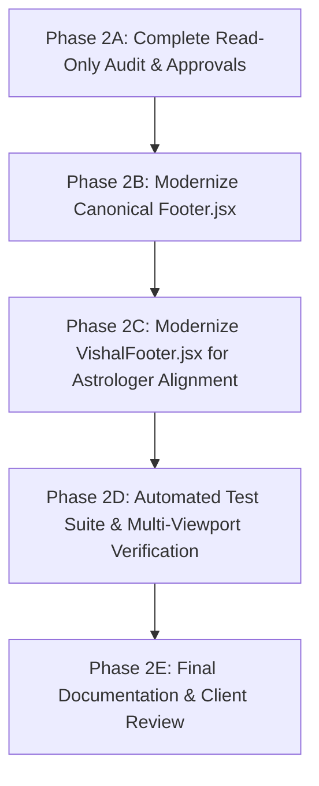

# VEDA STRUCTURE: FOOTER REDESIGN — PHASE 2A
## Read-Only Footer Architecture and UI Audit Report

**Date:** November 25, 2026  
**Auditor:** Senior React Architect & UI/UX Engineer  
**Scope:** `frontend-user1/src/components/layout/Footer.jsx` & `frontend-user1/src/components/layout/VishalFooter.jsx`  
**Audit Mode:** STRICT READ-ONLY AUDIT (Zero source code, CSS, route, or backend modifications)

---

## 1. EXECUTIVE SUMMARY

Following the successful completion of **Phase 1** (which created canonical routes for Privacy, Terms, Refund Policy, Shipping Policy, Contact Support, and FAQs), this Phase 2A audit establishes the forensic baseline and architecture plan for Phase 2: **Footer Redesign and Layout Modernization**.

### Core Audit Takeaways:
1. **Critical Route Sanitization:** All legal and support destinations now have canonical routes. However, `Footer.jsx` still hardcodes legacy paths (`/shipping`, `/returns`), external staging URLs (`https://veda-library-five.vercel.app/library`), dummy telephone numbers (`+91 98765 43210`), and unbuilt modules (`/shop`, `/prasad`, `/courses`, `/orders`, `/bookings`).
2. **Height & Bloat Reduction:** The current canonical footer stands at **>760px** on desktop and **>1,800px** on mobile across 12 stacked blocks. A modern, 4-column layout will reduce vertical footprint by ~50% while improving legibility and reverence.
3. **Dual Footer Alignment:** `VishalFooter.jsx` provides specialized astrologer navigation, but currently references unbuilt routes (`/products`, `/courses`, `/bookings`). It must be aligned with Phase 1 canonical routes while preserving its 1-on-1 consultation focus.
4. **Zero Risk Implementation Strategy:** Phase 2 will be batched into safe, incremental steps with automated regression tests to guarantee zero disruption to existing ritual booking flows, astrologer journeys, or the Veda Library.

---

## 2. CURRENT FOOTER ARCHITECTURE

The application mounts two distinct footer components across its route hierarchy:

```
┌─────────────────────────────────────────────────────────────────────────────┐
│                          APPLICATION ROUTE MATRIX                           │
├──────────────────────────────────────┬──────────────────────────────────────┤
│ MainLayout.jsx & YagyaPujaLayout.jsx │ VishalLayout.jsx                     │
│ -> Mounts: Footer.jsx                │ -> Mounts: VishalFooter.jsx          │
│ Routes:                              │ Routes:                              │
│ • Home (/)                           │ • /astrologers/vishal-bhardwaj       │
│ • /yagya-puja/* (Puja, Yagya, etc.)  │ • /astrologers/vishal-bhardwaj/book  │
│ • /puja/upcoming                     │ • /astrologers/acharya-anurag-*      │
│ • /book-consultation                 │ • /astrologers/:slug/book            │
│ • /community/*                       │                                      │
│ • /library/*                         │                                      │
│ • /privacy, /terms, /contact, /faqs  │                                      │
└──────────────────────────────────────┴──────────────────────────────────────┘
```

### 2.1 Canonical Footer (`Footer.jsx` — 369 Lines)
- **File Location:** [`frontend-user1/src/components/layout/Footer.jsx`](file:///c:/Users/shiva/Desktop/FreeLance_veda/frontend-user1/src/components/layout/Footer.jsx)
- **Parent Layouts:**
  - [`MainLayout.jsx`](file:///c:/Users/shiva/Desktop/FreeLance_veda/frontend-user1/src/components/layout/MainLayout.jsx) (L15)
  - [`YagyaPujaLayout.jsx`](file:///c:/Users/shiva/Desktop/FreeLance_veda/frontend-user1/src/layouts/YagyaPujaLayout.jsx) (L19)
- **Visual Composition:** Heavy multi-layered container with warm golden ambient aura glow divs (`bg-amber-400/20`, `bg-orange-400/15`), double gradients, and 4 major horizontal slices.

### 2.2 Specialized Astrologer Footer (`VishalFooter.jsx` — 170 Lines)
- **File Location:** [`frontend-user1/src/components/layout/VishalFooter.jsx`](file:///c:/Users/shiva/Desktop/FreeLance_veda/frontend-user1/src/components/layout/VishalFooter.jsx)
- **Parent Layout:**
  - [`VishalLayout.jsx`](file:///c:/Users/shiva/Desktop/FreeLance_veda/frontend-user1/src/layouts/VishalLayout.jsx) (L18)
- **Visual Composition:** 4-column flat parchment grid (`bg-[#f8edd8]`, border `#ead8b8`), focused on Jyotish consultations and trust badges.

---

## 3. SECTION-BY-SECTION INVENTORY

### 3.1 `Footer.jsx` Section Breakdown

| Section ID | Name / Description | Code Lines | Displayed Fields & Elements | Current Issues |
|---|---|---|---|---|
| **F-SEC-1** | **Sacred Shloka & Trust Promises Ribbon** | L24–82 | • Sacred Shloka: *ॐ असतो मा सद्गमय...*<br>• Upanishad translation quote<br>• 4 Trust Pillar Cards: *100% Vedic Authentic*, *Worldwide Delivery*, *Verified Acharyas*, *Sacred Packaging* | Takes up 180px of vertical space with heavy borders, deep gradients, and bulky drop shadows. Dominates above the actual navigation. |
| **F-SEC-2** | **Brand Identity & Contact Card** | L89–232 | • Logo SVG + Wordmark ("VEDA STRUCTURE")<br>• Tagline ("WISDOM, WORLDWIDE")<br>• Mission paragraph (40 words)<br>• Verified Contact Card (Support email, Phone, Spiritual Sanctum)<br>• 5 Social Media Icon Buttons | • Phone number is fake placeholder (`+91 98765 43210`)<br>• Social buttons link to generic root domains (`instagram.com`, `youtube.com`) rather than brand profiles<br>• Duplicate WhatsApp button |
| **F-SEC-3A** | **Navigation: Sacred Rituals** | L237–262 | • 6 Category links: *Puja Ceremonies*, *Vedic Yagya*, *Japa Anushthana*, *Shastric Path*, *Vedic Homa & Havan*, *All Sacred Services* | All 6 links resolve cleanly to active canonical ritual catalog routes. Excellent foundation. |
| **F-SEC-3B** | **Navigation: Resources** | L264–304 | • 6 Links: *Sacred Shop*, *Temple Prasadam*, *Vedic Courses*, *Upcoming Puja*, *Book Consultation*, *Veda Library* | • 3 links (`/shop`, `/prasad`, `/courses`) point to unbuilt modules (404)<br>• Veda Library leaks to external staging URL (`https://veda-library-five.vercel.app/library`) |
| **F-SEC-3C** | **Navigation: Customer Care** | L307–332 | • 6 Links: *Contact Us*, *Common FAQs*, *My Bookings*, *My Orders*, *Shipping & Delivery*, *Returns & Refunds* | • 2 links (`/bookings`, `/orders`) point to unbuilt modules<br>• `/shipping` & `/returns` duplicate the bottom legal bar<br>• Resolves via redirects rather than canonical paths |
| **F-SEC-4** | **Bottom Legal & Copyright Bar** | L338–366 | • Copyright statement (`© 2026 Veda Structure`)<br>• 4 Legal Links: *Privacy Policy*, *Terms & Conditions*, *Shipping Policy*, *Refunds & Cancellations*<br>• Sanctum tag: *Sanatan Dharma Sanctuary · Varanasi* | Links still point to legacy `/shipping` and `/returns` instead of canonical `/shipping-policy` and `/refund-policy`. |

---

### 3.2 `VishalFooter.jsx` Section Breakdown

| Section ID | Name / Description | Code Lines | Displayed Fields & Elements | Current Issues |
|---|---|---|---|---|
| **VF-SEC-1** | **Brand & Trust Identity** | L9–50 | • Logo + "VEDA STRUCTURE" + "WISDOM, WORLDWIDE"<br>• Jyotish description paragraph<br>• 2 Micro Trust Badges (*100% Confidential*, *Direct 1-on-1 Sessions*) | Clean, concise presentation. |
| **VF-SEC-2** | **Consultation Navigation** | L52–89 | • In-page anchors: `#guidance-section`, `#packages`, `#profile`, `#faq`<br>• Direct CTA: `/astrologers/vishal-bhardwaj/book-consultation` | Hash anchors break when user is on a nested consultation route (`/book-consultation` or `/booking-status`). |
| **VF-SEC-3** | **Explore Veda** | L91–122 | • 4 Links: `/` (Marketplace), `/astrologers` (All Astrologers), `/courses` (Sanatan Courses), `/products` (Sacred Products) | 2 links (`/courses`, `/products`) point to unbuilt modules (404). |
| **VF-SEC-4** | **Support & Trust** | L124–155 | • 4 Links: `/contact`, `/privacy`, `/terms`, `/bookings` | • `/contact`, `/privacy`, `/terms` now resolve cleanly (thanks to Phase 1)<br>• `/bookings` points to unbuilt module (404) |
| **VF-SEC-5** | **Bottom Copyright Bar** | L158–165 | • Copyright statement (`© 2026 Veda Structure`)<br>• Sanctum tagline (*Rooted in Kashi Vishwanath Tradition • Built with Reverence*) | Minimal and effective. |

---

## 4. LINK VERIFICATION TABLE

Every link across both footers audited against the verified route table:

| Footer Component | Item Label | Destination Target | Route Exists? | Canonical Status | Action for Phase 2 |
|---|---|---|---|---|---|
| **Footer.jsx** | Brand Logo | `/` | YES | Canonical | **Preserve** |
| **Footer.jsx** | Email Support | `mailto:support@vedastructure.com` | YES | Canonical | **Preserve** |
| **Footer.jsx** | WhatsApp Phone | `https://wa.me/919876543210` | DUMMY | Fake Phone | **Remove / Replace** with support action |
| **Footer.jsx** | Social: Instagram | `https://instagram.com` | GENERIC | Generic domain | **Remove** unless official handle verified |
| **Footer.jsx** | Social: YouTube | `https://youtube.com` | GENERIC | Generic domain | **Remove** unless official handle verified |
| **Footer.jsx** | Social: Facebook | `https://facebook.com` | GENERIC | Generic domain | **Remove** unless official handle verified |
| **Footer.jsx** | Social: X (Twitter) | `https://x.com` | GENERIC | Generic domain | **Remove** unless official handle verified |
| **Footer.jsx** | Social: WhatsApp | `https://whatsapp.com` | REDUNDANT | Duplicate of contact | **Remove** |
| **Footer.jsx** | Puja Ceremonies | `/yagya-puja/puja` | YES | Canonical | **Preserve** |
| **Footer.jsx** | Vedic Yagya | `/yagya-puja/yagya` | YES | Canonical | **Preserve** |
| **Footer.jsx** | Japa Anushthana | `/yagya-puja/japa` | YES | Canonical | **Preserve** |
| **Footer.jsx** | Shastric Path | `/yagya-puja/path` | YES | Canonical | **Preserve** |
| **Footer.jsx** | Vedic Homa & Havan | `/yagya-puja/homa` | YES | Canonical | **Preserve** |
| **Footer.jsx** | All Sacred Services | `/yagya-puja` | YES | Canonical | **Preserve** |
| **Footer.jsx** | Sacred Shop | `/shop` | **NO (404)** | Unbuilt module | **Remove** |
| **Footer.jsx** | Temple Prasadam | `/prasad` | **NO (404)** | Unbuilt module | **Remove** |
| **Footer.jsx** | Vedic Courses | `/courses` | **NO (404)** | Unbuilt module | **Remove** |
| **Footer.jsx** | Upcoming Puja | `/puja/upcoming` | YES | Canonical | **Preserve** |
| **Footer.jsx** | Book Consultation | `/book-consultation` | YES | Canonical | **Preserve** |
| **Footer.jsx** | Veda Library | `https://veda-library-five.vercel.app/library` | **EXTERNAL** | Staging leak | **Replace with internal** `<Link to="/library">` |
| **Footer.jsx** | Contact Us | `/contact` | YES | Canonical | **Preserve** |
| **Footer.jsx** | Common FAQs | `/faqs` | YES | Canonical | **Preserve** |
| **Footer.jsx** | My Bookings | `/bookings` | **NO (404)** | Unbuilt module | **Remove** |
| **Footer.jsx** | My Orders | `/orders` | **NO (404)** | Unbuilt module | **Remove** |
| **Footer.jsx** | Shipping & Delivery | `/shipping` | REDIRECT | Legacy alias | **Update to canonical** `/shipping-policy` |
| **Footer.jsx** | Returns & Refunds | `/returns` | REDIRECT | Legacy alias | **Update to canonical** `/refund-policy` |
| **Footer.jsx** | Privacy Policy (Bottom) | `/privacy` | YES | Canonical | **Preserve** |
| **Footer.jsx** | Terms & Conditions (Bottom) | `/terms` | YES | Canonical | **Preserve** |
| **Footer.jsx** | Shipping Policy (Bottom) | `/shipping` | REDIRECT | Legacy alias | **Update to canonical** `/shipping-policy` |
| **Footer.jsx** | Refunds & Cancellations (Bottom) | `/returns` | REDIRECT | Legacy alias | **Update to canonical** `/refund-policy` |
| **VishalFooter.jsx** | Brand Logo | `/` | YES | Canonical | **Preserve** |
| **VishalFooter.jsx** | Guidance Explorer | `#guidance-section` | ANCHOR | Detail-only hash | **Update to absolute path** |
| **VishalFooter.jsx** | Packages & Pricing | `#packages` | ANCHOR | Detail-only hash | **Update to absolute path** |
| **VishalFooter.jsx** | About Astrologer | `#profile` | ANCHOR | Detail-only hash | **Update to absolute path** |
| **VishalFooter.jsx** | Consultation FAQs | `#faq` | ANCHOR | Detail-only hash | **Update to absolute path** or `/faqs` |
| **VishalFooter.jsx** | Book Session Now | `/astrologers/vishal-bhardwaj/book-consultation` | YES | Canonical | **Preserve** |
| **VishalFooter.jsx** | Veda Marketplace | `/` | YES | Canonical | **Preserve** |
| **VishalFooter.jsx** | All Vedic Astrologers | `/astrologers` | YES | Canonical | **Preserve** |
| **VishalFooter.jsx** | Sanatan Courses | `/courses` | **NO (404)** | Unbuilt module | **Remove / Replace** with `/yagya-puja` |
| **VishalFooter.jsx** | Sacred Products & Prasadam | `/products` | **NO (404)** | Unbuilt module | **Remove / Replace** with `/library` |
| **VishalFooter.jsx** | Contact Support | `/contact` | YES | Canonical | **Preserve** |
| **VishalFooter.jsx** | Privacy & Data Policy | `/privacy` | YES | Canonical | **Preserve** |
| **VishalFooter.jsx** | Terms of Service | `/terms` | YES | Canonical | **Preserve** |
| **VishalFooter.jsx** | Manage My Bookings | `/bookings` | **NO (404)** | Unbuilt module | **Remove / Replace** with `/refund-policy` |

---

## 5. REDUNDANT AND UNNECESSARY FIELDS

### 5.1 Content to Eliminate Completely
1. **Unbuilt Module Links:**
   - `/shop` (Sacred Shop)
   - `/prasad` (Temple Prasadam)
   - `/courses` (Vedic Courses)
   - `/orders` (My Orders)
   - `/bookings` (My Bookings)
   - `/products` (Sacred Products)
2. **Fake Placeholder Phone:**
   - `+91 98765 43210` (Exposing fake phone numbers degrades spiritual authenticity).
3. **Generic Social Media Links:**
   - Root homepages (`instagram.com`, `youtube.com`, `facebook.com`, `x.com`, `whatsapp.com`) without authenticated brand usernames.
4. **Duplicated Policies:**
   - Eliminating the duplication between Column 3 ("Customer Care") and the bottom legal bar by assigning legal policies exclusively to their designated column or bottom bar.
5. **Bulky Trust Card Containers:**
   - The 4 bulky trust cards with oversized drop shadows take up 180px of vertical height. Streamlining them into a quiet, refined horizontal trust badge strip preserves spiritual reverence while reclaiming space.

---

## 6. PROPOSED MAIN FOOTER LAYOUT (`Footer.jsx`)

The proposed modern structure organizes all verified content into a clean, disciplined 4-column architecture using Veda Structure's authentic palette:

```
┌────────────────────────────────────────────────────────────────────────────────────────┐
│  TOP RIBBON: Sacred Shloka & Subtle Trust Bar                                          │
│  ॐ असतो मा सद्गमय । तमसो मा ज्योतिर्गमय । मृत्योर्मा अमृतं गमय ॥                                │
│  ✦ 100% Vedic Authentic   ✦ Verified Kashi Acharyas   ✦ Worldwide Sankalpa Dedicated   │
├──────────────────────────┬───────────────────────┬───────────────────┬─────────────────┤
│ COLUMN 1: BRAND          │ COLUMN 2: SACRED      │ COLUMN 3: WISDOM  │ COLUMN 4: TRUST │
│                          │ RITUALS               │ & CONSULTATIONS   │ & POLICIES      │
│ • VEDA STRUCTURE Logo    │ • Puja Ceremonies     │ • Astrologer      │ • Contact Us    │
│ • WISDOM, WORLDWIDE      │ • Vedic Yagya         │   Consultation    │ • Common FAQs   │
│ • Concise mission text   │ • Japa Anushthana     │ • All Astrologers │ • Privacy       │
│ • Spiritual Sanctum:     │ • Shastric Path       │ • Veda Library    │   Policy        │
│   Kashi (Varanasi)       │ • Vedic Homa & Havan  │   (Internal Link!)│ • Terms &       │
│ • Verified Email Action: │ • Upcoming Community  │ • Community       │   Conditions    │
│   support@vedastructure  │   Pujas               │   Directory       │ • Refund Policy │
│                          │ • All Sacred Services │                   │ • Shipping      │
│                          │                       │                   │   Policy        │
├──────────────────────────┴───────────────────────┴───────────────────┴─────────────────┤
│ BOTTOM BAR: © 2026 Veda Structure. All rights reserved.  ·  Sanatan Dharma Sanctuary   │
└────────────────────────────────────────────────────────────────────────────────────────┘
```

### Column Architecture Specifications:

#### Top Ribbon: Sacred Shloka & Subtle Trust Badges
- **Height:** ~64px (down from 180px).
- **Background:** Soft warm ivory `#F8F1E6` with subtle `#EAD8BC` divider.
- **Content:**
  - Sacred Shloka: *“ॐ असतो मा सद्गमय । तमसो मा ज्योतिर्गमय । मृत्योर्मा अमृतं गमय ॥”* (Brihadaranyaka Upanishad).
  - 3 clean, horizontal trust badges with antique gold icons:
    - `100% Vedic Authentic`
    - `Verified Kashi Acharyas`
    - `Worldwide Sankalpa Fulfillment`

#### Column 1: Brand & Spiritual Sanctum (3.5 cols on desktop)
- **Logo:** Existing sacred yantra mark with subtle gold aura.
- **Wordmark:** `VEDA STRUCTURE` in serif typography.
- **Tagline:** `WISDOM, WORLDWIDE` in antique gold (`#B77920`).
- **Description:** *“Preserving authentic Vedic rituals, sacred shastric learning, and temple ceremonies with reverent transparency and spiritual purity.”*
- **Sanctum Badge:** *Spiritual Sanctum: Kashi (Varanasi), Uttar Pradesh, India*.
- **Verified Support:** Direct link `mailto:support@vedastructure.com`.

#### Column 2: Sacred Rituals (2.8 cols on desktop)
Direct canonical links to all five ritual streams:
1. `Puja Ceremonies` (`/yagya-puja/puja`)
2. `Vedic Yagya` (`/yagya-puja/yagya`)
3. `Japa Anushthana` (`/yagya-puja/japa`)
4. `Shastric Path` (`/yagya-puja/path`)
5. `Vedic Homa & Havan` (`/yagya-puja/homa`)
6. `Upcoming Community Pujas` (`/puja/upcoming`)
7. `All Sacred Rituals` (`/yagya-puja`)

#### Column 3: Wisdom & Consultations (2.8 cols on desktop)
1. `Book Astrologer Consultation` (`/book-consultation`)
2. `All Vedic Astrologers` (`/astrologers`)
3. `Veda Library` (`/library`) — **Internal client-side `<Link>`, terminating the staging leak!**
4. `Veda Structure Community` (`/community`)

#### Column 4: Trust, Support & Policies (2.9 cols on desktop)
Consolidates all customer assistance and legal compliance into one coherent column:
1. `Contact Devotee Support` (`/contact`)
2. `Frequently Asked Questions` (`/faqs`)
3. `Privacy & Data Policy` (`/privacy`)
4. `Terms & Conditions` (`/terms`)
5. `Refund & Cancellation Policy` (`/refund-policy`)
6. `Shipping & Delivery Policy` (`/shipping-policy`)

#### Bottom Bar: Copyright & Attribution
- Clean, uncluttered single row:
  - Left: `© 2026 Veda Structure. All rights reserved.`
  - Center/Right: `Sanatan Dharma Sanctuary · Varanasi (Kashi), India`

---

## 7. PROPOSED VISHALFOOTER LAYOUT (`VishalFooter.jsx`)

To ensure visual harmony while honoring its dedicated purpose on Astrologer profile pages:

```
┌────────────────────────────────────────────────────────────────────────────────────────┐
│ COLUMN 1: JYOTISH SANCTUM│ COLUMN 2: CONSULTATION│ COLUMN 3: SACRED  │ COLUMN 4: TRUST │
│                          │ GUIDANCE              │ DISCOVERY         │ & POLICIES      │
│ • VEDA STRUCTURE Logo    │ • Complete Kundali    │ • Sacred Rituals  │ • Contact       │
│ • JYOTISH SANCTUM        │   Analysis            │   (/yagya-puja)   │   Support       │
│ • 1-on-1 Confidential    │ • Remedial Guidance   │ • Veda Library    │ • Consultation  │
│   Consultation copy      │ • About Astrologer    │   (/library)      │   FAQs (/faqs)  │
│ • Trust Badges:          │   Vishal              │ • All Vedic       │ • Privacy       │
│   - 100% Confidential    │ • Book Consultation   │   Astrologers     │   Policy        │
│   - Direct Video/Audio   │   Now (Direct CTA)    │ • Upcoming Pujas  │ • Terms of      │
│                          │                       │   (/puja/upcoming)│   Service       │
│                          │                       │                   │ • Refund Policy │
├──────────────────────────┴───────────────────────┴───────────────────┴─────────────────┤
│ BOTTOM BAR: © 2026 Veda Structure.  ·  Rooted in Kashi Vishwanath Tradition            │
└────────────────────────────────────────────────────────────────────────────────────────┘
```

### Key VishalFooter Adjustments:
1. **Remove Broken Links:** Eliminate `/courses`, `/products`, and `/bookings`.
2. **Fix Hash Anchors:** Replace fragment identifiers (`#guidance-section`) with full routes or graceful path-aware targets so links don't break when navigating from sub-pages like `/book-consultation`.
3. **Connect Canonical Policies:** Link directly to `/privacy`, `/terms`, `/refund-policy`, `/contact`, and `/faqs`.
4. **Color Alignment:** Maintain `#F8F1E6` background and `#EAD8BC` borders to match the platform's visual identity.

---

## 8. RESPONSIVE DESIGN RECOMMENDATIONS

| Viewport Breakpoint | Column Behavior | Padding & Spacing | Typography Sizing |
|---|---|---|---|
| **Desktop (≥ 1280px)** | 4-column horizontal grid (`grid-cols-12` or `grid-cols-4`). Max container width `1240px`. | `py-10 px-8` | Headers: `text-[13.5px] font-bold tracking-wider`<br>Links: `text-[13.5px] leading-relaxed` |
| **Laptop (1024px - 1279px)** | 4-column grid with slightly condensed gap (`gap-6`). | `py-8 px-6` | Headers: `text-[13px]`<br>Links: `text-[13px]` |
| **Tablet (768px - 1023px)** | 2x2 grid: Top row (Brand & Sacred Rituals), Bottom row (Wisdom & Policies). | `py-8 px-6` | Headers: `text-[13px]`<br>Links: `text-[13px]` |
| **Mobile (< 768px)** | Clean, single-column stack. Sacred Shloka ribbon collapses to centered blessing. Brand and 3 navigation groups stack with generous touch targets (`min-h-[44px]`). | `py-8 px-4` | Headers: `text-[14px]`<br>Links: `text-[14px] py-1` |

---

## 9. IMPLEMENTATION SEQUENCE FOR SUBSEQUENT BATCHES

To guarantee zero regression and seamless review, the redesign should proceed in the following orderly sequence:



1. **Batch 2B — Main Footer Implementation (`Footer.jsx`):**
   - Replace cluttered 369-line implementation with the clean 4-column layout.
   - Connect all canonical routes (`/privacy`, `/terms`, `/refund-policy`, `/shipping-policy`, `/contact`, `/faqs`).
   - Switch Veda Library link to internal `<Link to="/library">`.
   - Prune fake phone number and unbuilt module links.
   - Streamline Shloka ribbon to ~64px height.
2. **Batch 2C — Astrologer Footer Implementation (`VishalFooter.jsx`):**
   - Clean up broken links (`/courses`, `/products`, `/bookings`).
   - Connect canonical policy routes and `/library`.
   - Ensure hash anchor safety across sub-routes.
3. **Batch 2D — Verification & Testing:**
   - Run production Vite build (`npm --prefix frontend-user1 run build`).
   - Run automated route verification test suite.
   - Verify layout responsiveness at 1440px, 1024px, 768px, and 390px.

---

## 10. FILES THAT WILL NEED MODIFICATION IN SUBSEQUENT BATCHES

| Target File | Expected Changes |
|---|---|
| [`frontend-user1/src/components/layout/Footer.jsx`](file:///c:/Users/shiva/Desktop/FreeLance_veda/frontend-user1/src/components/layout/Footer.jsx) | Full layout modernization; replace 4-slice structure with 4-column architecture; eliminate unbuilt links and staging URL; streamline shloka ribbon. |
| [`frontend-user1/src/components/layout/VishalFooter.jsx`](file:///c:/Users/shiva/Desktop/FreeLance_veda/frontend-user1/src/components/layout/VishalFooter.jsx) | Clean up dead links; update to canonical legal routes; improve hash anchor resilience. |
| [`frontend-user1/src/routes/testFooterPhase1Routes.cjs`](file:///c:/Users/shiva/Desktop/FreeLance_veda/frontend-user1/src/routes/testFooterPhase1Routes.cjs) | Expand automated test suite to assert new footer link inventory and verify 0 broken links across both footers. |

---

## 11. RISKS AND REGRESSION TEST RECOMMENDATIONS

| Potential Risk | Severity | Prevention & Verification Strategy |
|---|---|---|
| **Veda Library Navigation Interruption** | High | Ensure `<Link to="/library">` uses client-side routing and does not refresh or remount the library context state. Verify that `/library`, `/library/tree`, and `/library/:topicSlug` continue functioning seamlessly. |
| **Active Ritual Booking Flow Regressions** | High | Verify that mounting the new footer does not introduce CSS bleeding or layout shift to active booking wizards on `/yagya-puja/puja/:slug/book`, `/yagya-puja/yagya/:slug/book`, etc. |
| **Astrologer Hash Navigation Mismatch** | Medium | When users are on `/astrologers/vishal-bhardwaj/book-consultation`, in-page hash links (`#guidance-section`) must not fail silently. Provide full path anchors (`/astrologers/vishal-bhardwaj#guidance-section`). |
| **Styling Consistency & Color Bleed** | Low | Adhere strictly to the approved Tailwind color tokens (`bg-[#fffaf0]`, `bg-[#f8f1e6]`, `border-[#ead8bc]`, `text-[#b77920]`, `text-[#30251c]`). |

---
*Audit completed under strict read-only protocols. Awaiting client review and approval before beginning Phase 2B implementation.*
