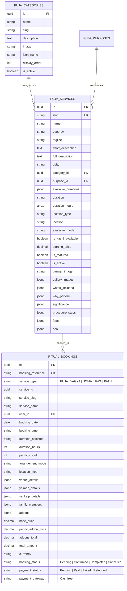
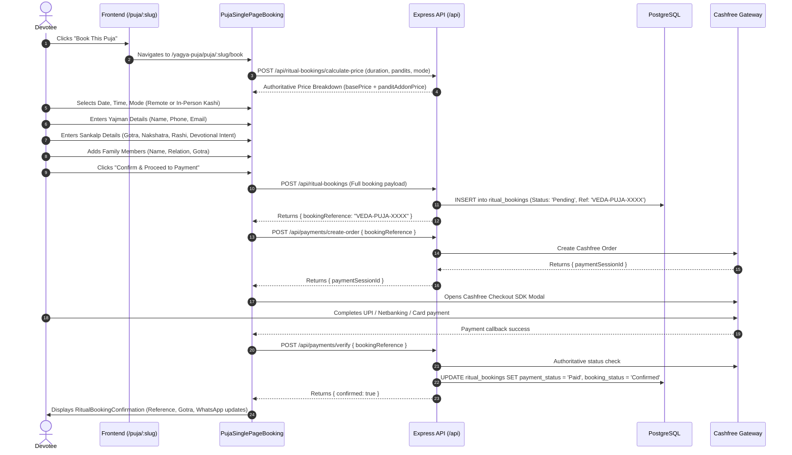

# VEDA STRUCTURE: YAGYA & PUJA MODULE COMPLETE ARCHITECTURAL AUDIT

**Audit Date:** November 26, 2026  
**Auditor:** Senior System Architect & UI/UX Specialist  
**Mode:** Strictly Read-Only (No code or database modifications)  
**Target Proposal:** Integration of new **"Special Puja"** section (16 Samskars, Birthday Puja, Pinda Daan, Tirth Shradh)

---

## 1. Executive Summary

This technical audit provides an exhaustive examination of the **Yagya & Puja Module** across the entire Veda Structure platform:
- **Public Client Frontend (`frontend-user1`):** React 19, Vite 8, React Router 7, Tailwind CSS 4.
- **Backend Core (`backend`):** Node.js, Express.js, PostgreSQL (Sequelize ORM), Cashfree Payment Gateway, Cloudinary Image Storage.
- **Admin Control Panel (`admin-veda-structure`):** React 18 / 19, TypeScript, Tailwind CSS, Vite.

### Key Architectural Discovery
The platform implements an **isolated sub-application pattern** for the ritual experience under the `/yagya-puja/*` namespace. Currently, **five canonical ritual disciplines** are fully implemented in a symmetrical, parallel pattern:
1. **Puja** (`/yagya-puja/puja/*`)
2. **Yagya** (`/yagya-puja/yagya/*`)
3. **Japa** (`/yagya-puja/japa/*`)
4. **Path** (`/yagya-puja/path/*`)
5. **Homa** (`/yagya-puja/homa/*`)
*(Plus a 6th entry: "Puja in Kashi", which acts as a filtered gateway to `/puja` / Kashi ceremonies).*

Alongside this on-demand catalogue sits a separate **Community Upcoming Puja** subsystem (`/puja` & `/puja/upcoming`), which handles group Sankalpa tier bookings (Silver, Gold, Platinum packages).

### Core Takeaway for "Special Puja"
The planned **Special Puja** section (covering 16 Shodasha Samskar ceremonies, Birthday Puja, Pinda Daan, and Tirth Shradh) can **maximally leverage the existing Puja and Ritual Booking infrastructure**. The system has two viable integration paths:
- **Strategy 1 (Puja Category Sub-System):** Model Special Puja categories (`shodasha-samskar`, `birthday-puja`, `pinda-daan`, `tirth-shradh`) as standard `PujaCategory` and `PujaService` records. Reuses 90%+ of frontend, backend, admin, and booking logic with zero database schema migrations.
- **Strategy 2 (Dedicated 6th Discipline Sub-System):** Model Special Puja as a distinct 6th first-class discipline (`SpecialPujaService`, `SpecialPujaCategory`, `serviceType: "SPECIAL_PUJA"`). Follows the exact blueprint used by Homa/Japa/Path, requiring migration of tables and enum extensions.

---

## 2. Frontend Architecture (`frontend-user1`)

### 2.1 File & Directory Map
The frontend architecture for rituals is organized across two directories:

```
frontend-user1/
├── src/
│   ├── layouts/
│   │   ├── YagyaPujaLayout.jsx              # Dedicated header/footer wrapper for /yagya-puja/*
│   │   └── MainLayout.jsx                   # Global layout for homepage, library, consultation
│   ├── components/layout/
│   │   ├── Navbar.jsx                       # Global website header (Row 1 brand + Row 2 nav)
│   │   └── Footer.jsx                       # Canonical 4-column footer
│   ├── features/yagyaPuja/                  # Core On-Demand Ritual Engine
│   │   ├── components/
│   │   │   ├── YagyaPujaNavBar.jsx          # Dedicated 2-row ritual navigation with mega-dropdowns
│   │   │   ├── PujaServiceCard.jsx          # Reusable card component for Puja listings
│   │   │   ├── YagyaServiceCard.jsx         # Reusable card component for Yagya listings
│   │   │   ├── HomaServiceCard.jsx          # Reusable card component for Homa listings
│   │   │   ├── JapaServiceCard.jsx          # Reusable card component for Japa listings
│   │   │   ├── PathServiceCard.jsx          # Reusable card component for Path listings
│   │   │   ├── booking/                     # Booking wizard & single-page booking interfaces
│   │   │   │   ├── PujaSinglePageBooking.jsx
│   │   │   │   ├── YagyaSinglePageBooking.jsx
│   │   │   │   ├── HomaSinglePageBooking.jsx
│   │   │   │   ├── JapaSinglePageBooking.jsx
│   │   │   │   ├── PathSinglePageBooking.jsx
│   │   │   │   ├── StepConfiguration.jsx
│   │   │   │   ├── StepYajman.jsx
│   │   │   │   ├── StepSankalp.jsx
│   │   │   │   ├── StepFamilyMembers.jsx
│   │   │   │   ├── StepLocation.jsx
│   │   │   │   ├── StepAddons.jsx
│   │   │   │   ├── StepReview.jsx
│   │   │   │   └── RitualBookingConfirmation.jsx
│   │   │   └── umbrella/                    # Shared sections across landing and catalogues
│   │   │       ├── UmbrellaHero.jsx
│   │   │       ├── UmbrellaWhyVeda.jsx
│   │   │       ├── UmbrellaWorkflow.jsx
│   │   │       └── UmbrellaFaq.jsx
│   │   ├── context/
│   │   │   └── RitualBookingContext.jsx     # Global multi-step and single-page booking state
│   │   ├── pages/
│   │   │   ├── YagyaPujaLanding.jsx         # /yagya-puja umbrella portal
│   │   │   ├── PujaCatalogueListing.jsx     # /yagya-puja/puja listing
│   │   │   ├── PujaAllCatalogueListing.jsx  # /yagya-puja/puja/all grid view
│   │   │   ├── PujaCategoryListing.jsx      # /yagya-puja/puja/category/:categorySlug
│   │   │   ├── PujaServiceDetails.jsx       # /yagya-puja/puja/:slug detail page
│   │   │   ├── YagyaCatalogueListing.jsx    # /yagya-puja/yagya listing
│   │   │   ├── YagyaServiceDetails.jsx      # /yagya-puja/yagya/:slug detail page
│   │   │   ├── RitualBookingWizard.jsx      # /yagya-puja/:type/:slug/book route dispatcher
│   │   │   └── ... (Japa, Path, Homa equivalents)
│   │   └── services/
│   │       └── pathCatalogueService.js      # Internal catalogue service abstraction
│   ├── features/puja/                       # Community & Upcoming Group Puja Subsystem
│   │   ├── pages/
│   │   │   ├── PujaListing.jsx              # /puja & /puja/upcoming listing page
│   │   │   ├── UpcomingPujaAll.jsx          # /puja/upcoming/all calendar & card view
│   │   │   └── PujaDetails.jsx              # /puja/:slug group package booking
│   │   └── components/
│   │       ├── PujaPackages.jsx             # Package selector (Silver, Gold, Platinum)
│   │       └── SankalpForm.jsx              # Modal form for group Sankalp
│   └── services/
│       ├── api.js                           # Axios instance with baseURL /api
│       ├── pujaCatalogueService.js          # Client API caller for Puja services & categories
│       ├── yagyaCatalogueService.js         # Client API caller for Yagya services & categories
│       ├── japaCatalogueService.js          # Client API caller for Japa services & categories
│       ├── pathCatalogueService.js          # Client API caller for Path services & categories
│       ├── homaCatalogueService.js          # Client API caller for Homa services & categories
│       ├── upcomingPujaService.js           # Client API caller for group events
│       └── ritualBookingService.js          # Client API caller for price calculation & bookings
```

### 2.2 Navigation Components & Dropdown Implementation
1. **Global Header Navbar (`src/components/layout/Navbar.jsx`):**
   - Contains Row 1 (Emblem, Search, Profile, Wishlist) and Row 2 (Primary Navigation Links).
   - "Yagya & Puja" link: Explicitly renders as `<button type="button" onClick={() => window.open("/yagya-puja", "_blank", "noopener,noreferrer")}>`. Opens the dedicated portal in a fresh tab.
   - Also contains an external link labeled `"Tirth"` (`https://veda-puja-booking-spuu.vercel.app/`), indicating prior third-party experimentation with Tirth/Shradh services.
2. **Dedicated Ritual Navbar (`src/features/yagyaPuja/components/YagyaPujaNavBar.jsx`):**
   - **Row 1 (Utility Strip):** Vedic authenticity badges, Kashi Acharya verification, helpline direct link, and `"Main Website"` transition link.
   - **Row 2 (Discipline Strip):**
     - Left: Brand Logo & Wordmark ("VEDA STRUCTURE • Yagya & Puja").
     - Center: Nav tabs for `Upcoming Puja`, `Puja`, `Yagya`, `Japa`, `Path`, `Homa`, `Puja in Kashi`.
   - **Dynamic Mega-Dropdown Panel:**
     - Triggers on mouse enter or click on any tab.
     - Fetches live categories from the backend via the respective catalogue service (e.g. `pujaCatalogueService.getPujaCategories()`).
     - Features in-memory session caching (`cachedCategories`) to prevent network lag on repeat hovers.
     - Displays category cards with custom Lucide icons (`Flower2`, `Flame`, `Sun`, `BookOpen`, `Sparkles`), service counts, and direct links to category listing routes (`/yagya-puja/:type/category/:categorySlug`).
   - **Mobile Drawer (< lg):**
     - Accordion layout where tapping a discipline unfolds its categories dynamically.

---

## 3. Routing & URL Conventions

### 3.1 Route Hierarchy in `AppRoutes.jsx`
All ritual routes are nested inside `YagyaPujaLayout`:

| Route Pattern | Component | Purpose | Verification Status |
| :--- | :--- | :--- | :--- |
| `/yagya-puja` | `YagyaPujaLanding` | Umbrella landing page with discipline gateways | **Verified** |
| `/yagya-puja/puja` | `PujaCatalogueListing` | Puja category showcase, purpose filter, featured grid | **Verified** |
| `/yagya-puja/puja/all` | `PujaAllCatalogueListing` | Paginated grid of all active Puja ceremonies | **Verified** |
| `/yagya-puja/puja/category/:categorySlug` | `PujaCategoryListing` | Category-specific filtered listing | **Verified** |
| `/yagya-puja/puja/:slug` | `PujaServiceDetails` | Deep shastric detail page for a single Puja service | **Verified** |
| `/yagya-puja/puja/:slug/book` | `RitualBookingWizard` | Single-page / multi-step booking checkout | **Verified** |
| `/yagya-puja/yagya` | `YagyaCatalogueListing` | Multi-day Yagya catalogue showcase | **Verified** |
| `/yagya-puja/yagya/all` | `YagyaAllCatalogueListing` | Grid of all Yagya ceremonies | **Verified** |
| `/yagya-puja/yagya/category/:categorySlug` | `YagyaCategoryListing` | Yagya category-specific filtered listing | **Verified** |
| `/yagya-puja/yagya/:slug` | `YagyaServiceDetails` | Deep shastric detail page for a Yagya ceremony | **Verified** |
| `/yagya-puja/yagya/:slug/book` | `RitualBookingWizard` | Single-page Yagya booking checkout | **Verified** |
| `/yagya-puja/yagya/:slug/booking-status` | `YagyaBookingStatus` | Payment status & reservation receipt | **Verified** |
| `/yagya-puja/japa` | `JapaCatalogueListing` | Mantra Japa Anushthan catalogue | **Verified** |
| `/yagya-puja/japa/:slug` | `JapaServiceDetails` | Mantra Japa detail page | **Verified** |
| `/yagya-puja/japa/:slug/book` | `RitualBookingWizard` | Japa single-page booking checkout | **Verified** |
| `/yagya-puja/path` | `PathCatalogueListing` | Scripture recitation catalogue | **Verified** |
| `/yagya-puja/path/:slug` | `PathServiceDetails` | Scripture recitation detail page | **Verified** |
| `/yagya-puja/path/:slug/book` | `RitualBookingWizard` | Path single-page booking checkout | **Verified** |
| `/yagya-puja/homa` | `HomaCatalogueListing` | Vedic fire oblation catalogue | **Verified** |
| `/yagya-puja/homa/:slug` | `HomaServiceDetails` | Homa ceremony detail page | **Verified** |
| `/yagya-puja/homa/:slug/book` | `RitualBookingWizard` | Homa single-page booking checkout | **Verified** |
| `/yagya-puja/kashi` | `PujaListing` | Filtered gateway to Kashi ceremonies | **Verified** |

---

## 4. Catalogue & Service Data Architecture

### 4.1 Data Source & Normalization Flow
Data flow is **strictly dynamic and backend-driven**:
1. Frontend components do **not** rely on hardcoded mock JSON for catalogue content.
2. Services invoke centralized Axios clients in `frontend-user1/src/services/pujaCatalogueService.js`.
3. Normalizer functions (`mapApiPujaServiceToUi`, `mapApiPujaServiceDetailToUi`) parse raw PostgreSQL JSONB objects into consistent frontend data structures with fallback safety.

```
PostgreSQL (RDS/Local)
   └── Sequelize Models (`PujaService`, `PujaCategory`, `PujaPurpose`)
         └── Express Controllers (`pujaService.controller.js`)
               └── REST API (`GET /api/puja-services/:slug`)
                     └── Frontend Service (`pujaCatalogueService.js`)
                           └── Normalizer (`mapApiPujaServiceDetailToUi`)
                                 └── UI Component (`PujaServiceDetails.jsx`)
```

### 4.2 Data Normalization Model (Puja & Yagya)

| Field Name | Type | How It Is Handled / Normalized |
| :--- | :--- | :--- |
| `name` | String | Service title (e.g. "Sacred Rudrabhishek Puja"). |
| `slug` | String | URL identifier (e.g. `rudrabhishek-puja`). Generated via standard `slugify`. |
| `eyebrow` | String | Gold banner tag (e.g. "VEDIC PUJA • SHIVA SEVA"). |
| `tagline` | String | Subtitle quote displayed in italics. |
| `startingPrice` | Decimal | Formatted into currency string with symbol (`₹1,100`). |
| `availableMode` | Enum | Stored as `in_person`, `remote`, `hybrid`; normalized to `"In-Person (Kashi)"`, `"Remote Sankalpa"`, etc. |
| `duration` | String/Array | Displayed as string (e.g. "2–3 Hours") and mapped from integer array `durationHours: [2, 3, 5]`. |
| `bannerImage` | URL | CDN/Cloudinary image URL with local static fallback lookup (`SLUG_IMAGE_MAP`). |
| `galleryImages` | JSONB (Array) | Additional photo gallery items. |
| `whatsIncluded` | JSONB (Array) | Bulleted deliverables list (e.g. "Authentic Vedic Rudrabhishek Vidhi", "Pure Samagri", "Gotra Sankalp"). |
| `whyPerform` | JSONB (Array) | Array of objects `{ title: string, description: string, icon?: string }` describing devotional intentions. |
| `significance` | JSONB (Array) | Array of scriptural citations and classical background text. |
| `procedureSteps` | JSONB (Array) | Ordered ritual phases `{ step: "01", title: string, description: string }`. |
| `faqs` | JSONB (Array) | Array of Q&A objects `{ question: string, answer: string }`. |
| `seo` | JSONB (Object) | Custom SEO overrides `{ title, description, keywords, canonicalUrl }`. |

---

## 5. Individual Service Detail Page Audit

A direct code audit of representative pages was conducted:
- **Puja Representative:** `frontend-user1/src/features/yagyaPuja/pages/PujaServiceDetails.jsx`
- **Yagya Representative:** `frontend-user1/src/features/yagyaPuja/pages/YagyaServiceDetails.jsx`

### 5.1 Exact Component Section Comparison

| Section Number | Section Name | Present in Puja? | Present in Yagya? | Implementation Details |
| :---: | :--- | :---: | :---: | :--- |
| **0** | `PublicSEO` | **Yes** | **Yes** | Meta tag, title, and canonical URL synchronization. |
| **1** | **Hero & Breadcrumbs** | **Yes** | **Yes** | 4-level breadcrumbs (`Home > Yagya & Puja > Puja > Category > Service`). |
| **2** | **Image Gallery** | **Yes** | **Yes** | Main image with interactive thumbnail strip / slide controls. |
| **3** | **Key Metadata Badges** | **Yes** | **Yes** | Location (Kashi), Mode (Hybrid/Remote), Duration, Eyebrow. |
| **4** | **Pricing & Primary CTA** | **Yes** | **Yes** | Starting price display with instant "Book This Ceremony" navigation. |
| **5** | **Multi-Day Duration Selector** | *No* | **Yes** | Yagya has interactive multi-day tier buttons (3, 5, 7, 9, 11 Days). |
| **6** | **Pandit Team Requirement Card** | *No* | **Yes** | Yagya displays Min, Recommended, and Max Acharya count grid. |
| **7** | **About the Ceremony** | **Yes** | **Yes** | Full description with shastric overview. |
| **8** | **Feature Trust Grid** | **Yes** | *No* | 4-card trust grid: Authentic Vidhi, Vedic Acharyas, Gotra Sankalpa, Prasad. |
| **9** | **Devotional Significance (Why Perform)** | **Yes** | **Yes** | 4-card grid detailing spiritual benefits and intentions. |
| **10** | **Scriptural Significance** | **Yes** | **Yes** | Textual background references from Vedic shastras. |
| **11** | **What's Included (Deliverables)** | **Yes** | **Yes** | Checklist of inclusions (Samagri, Dakshina, Sankalp, Prasad). |
| **12** | **Sacred Samagri Breakdown** | *No* | **Yes** | Yagya features dedicated Ahuti Samagri list with status tags (`included`, `optional`). |
| **13** | **How It Is Performed (Vidhi Steps)** | **Yes** | *No* | Puja renders step-by-step phase timeline cards (e.g. 01 Sankalp, 02 Dhyanam). |
| **14** | **Multi-Day Daily Schedule** | *No* | **Yes** | Yagya renders day-by-day progression cards (Day 01, Day 02, etc.). |
| **15** | **When and Where (Scheduling & Venue)** | **Yes** | *No* | Puja details location types (Kashi Mandir, Ashram, Home) and tithi options. |
| **16** | **Service-Specific FAQs** | **Yes** | **Yes** | Interactive accordion Q&A section. |
| **17** | **Related Services Carousel/Grid** | **Yes** | **Yes** | 3-column card grid linking to other services in same discipline. |
| **18** | **Final Bottom Booking CTA** | **Yes** | **Yes** | Prominent full-width conversion banner. |

### 5.2 Reusability Analysis for Service Details
- `PujaServiceDetails.jsx` is **100% data-driven**. If a new service has no `procedureSteps` or `significance`, those sections conditionally hide without throwing errors.
- Therefore, services like **Birthday Puja**, **16 Samskars**, and **Pinda Daan** can render seamlessly using the existing `PujaServiceDetails` template.

---

## 6. Backend & API Integration Audit (`backend`)

### 6.1 Endpoint Directory
All ritual endpoints follow standard RESTful conventions:

#### Public Endpoints
- `GET /api/puja-services` — Paginated list with filtering (`search`, `purpose`, `category`, `duration`, `mode`, `isFeatured`, `sortBy`).
- `GET /api/puja-services/:slug` — Full service detail by slug.
- `GET /api/puja-services/purposes` — List of active devotional purposes.
- `GET /api/puja-categories` — List of active categories sorted by `display_order`.
- `GET /api/puja-categories/:slug` — Category metadata.
- `POST /api/ritual-bookings/calculate-price` — Authoritative price calculation engine.
- `POST /api/ritual-bookings` — Booking record creation.
- `GET /api/ritual-bookings/:bookingReference` — Booking retrieval by reference.
- `POST /api/payments/create-order` — Cashfree order session creation.
- `POST /api/payments/verify` — Payment verification.
- `GET /api/payments/booking-status/:bookingReference` — Public booking status check.

#### Admin Endpoints (Require `authenticate` + `authorizeAdmin` Middleware)
- `GET /api/admin/puja-services` — Full administrative catalogue with filters.
- `POST /api/admin/puja-services` — Create new service.
- `GET /api/admin/puja-services/:id` — Retrieve service by UUID.
- `PUT /api/admin/puja-services/:id` — Update service by UUID.
- `DELETE /api/admin/puja-services/:id` — Soft-delete or remove service.
- `GET /api/admin/puja-categories` — Manage categories.
- `POST /api/admin/puja-categories` — Create category.
- `PUT /api/admin/puja-categories/:id` — Update category.
- `DELETE /api/admin/puja-categories/:id` — Delete category.
- `POST /api/admin/uploads/images` — Cloudinary/disk multi-image upload handler.
- `GET /api/admin/ritual-bookings` — Master admin list of all ritual bookings.

---

## 7. Database Models & Schema Audit

### 7.1 Sequelize Models Breakdown
The database architecture uses PostgreSQL with JSONB columns for flexible ritual metadata:



### 7.2 Critical Schema Constraints for Special Puja
1. **`ritual_bookings.service_type` enum constraint:**
   In `backend/src/models/ritualBookingModel.js` line 27:
   ```javascript
   serviceType: {
     type: DataTypes.STRING(30),
     validate: {
       isIn: [["PUJA", "YAGYA", "HOMA", "JAPA", "PATH"]],
     },
   }
   ```
   If Special Puja uses `serviceType = "PUJA"`, **zero database schema changes are required**.
   If Special Puja requires its own type `serviceType = "SPECIAL_PUJA"`, a migration must execute `ALTER TABLE ritual_bookings DROP CONSTRAINT ...` / `ADD CONSTRAINT ...`.

---

## 8. Admin Panel Audit (`admin-veda-structure`)

The admin application is built in TypeScript and provides comprehensive CRUD management for every discipline:

### 8.1 Existing Admin Pages
- **Catalogue Tables:** `PujaServices.tsx`, `YagyaServices.tsx`, `HomaServices.tsx`, `JapaServices.tsx`, `PathServices.tsx`.
  - Supports searching, filtering by category/status, inline toggle for `isActive` and `isFeatured`, and direct edit/view links.
- **Service Forms:** `PujaServiceForm.tsx` (1,406 lines), `YagyaServiceForm.tsx` (1,259 lines).
  - Handles auto-slug generation, rich-text full descriptions, live image uploads to Cloudinary, duration arrays, and pricing.
  - Features bulk modal assistants: `BulkFaqModal`, `BulkStringListModal` (for What's Included, Why Perform, Significance, Steps).
- **Category Management:** `PujaCategories.tsx`, `PujaCategoryForm.tsx`.
  - Allows admins to create categories, assign Lucide icon names (`Sparkles`, `Flower2`, `Sun`, etc.), set display ordering, and upload category banners.
- **Booking Management:** `RitualBookings.tsx`, `RitualBookingDetail.tsx`.
  - Master order view showing Yajman name, Gotra, date, mode, Cashfree payment reference, and status progression (`Pending` -> `Confirmed` -> `Completed`).

### 8.2 Admin Reusability for Special Puja
If Special Puja is treated as categories under Puja:
- Administrators can immediately create categories:
  - `Shodasha Samskar`
  - `Birthday Puja`
  - `Pinda Daan`
  - `Tirth Shradh`
- Administrators can create the 16 Samskar services using `PujaServiceForm.tsx` without writing a single line of admin UI code.
- Admin changes become **immediately visible** on the public client because the frontend queries live endpoints.

---

## 9. Booking Journey Audit

The complete booking journey was verified through the codebase:



---

## 10. SEO & URL Architecture Audit

### 10.1 Existing Implementation
- **DOM Injection:** Managed through `PublicSEO.jsx` and `seoUtils.js`. Uses React 19-safe `useEffect` DOM manipulation to avoid duplicated `<title>` or `<meta>` tags.
- **Canonical Structure:** Deterministically resolves canonical URLs using `https://vedastructure.com/yagya-puja/{serviceType}/{slug}`.
- **Dynamic Sitemap:** `backend/src/controllers/sitemap.controller.js` queries all active services from `PujaService`, `YagyaService`, etc., and generates `<url>` entries with `<changefreq>daily</changefreq>` and `<priority>0.8</priority>`.

### 10.2 Recommendation for Special Puja URLs
Following the established pattern, Special Puja should adopt one of two URL architectures:
- **Category Pattern (Recommended):**
  - Section Portal: `/yagya-puja/special-puja`
  - Category Listing: `/yagya-puja/puja/category/samskar`
  - Service Detail: `/yagya-puja/puja/namakarana-samskar`
- **Dedicated Discipline Pattern:**
  - Section Portal: `/yagya-puja/special-puja`
  - Category Listing: `/yagya-puja/special-puja/category/:categorySlug`
  - Service Detail: `/yagya-puja/special-puja/:slug`

---

## 11. Special Puja Reusability Assessment

### 11.1 Proposed Services Breakdown

#### 1. Shodasha Samskar (16 Vedic Life-Cycle Ceremonies)
- **Services:** Garbhadhana, Pumsavana, Simantonayana, Jatakarma, Namakarana, Nishkramana, Annaprashana, Chudakarana (Mundan), Karnavedha, Vidyarambha, Upanayana (Janeu), Vedarambha, Keshanta/Ritushuddhi, Samavartana, Vivaha, Antyeshti.
- **Character:** Highly structured Vedic ceremonies, typically 2–4 hours or full day, involving specific Samagri (Janeu, Gangajal, holy grass), Gotra Sankalpa, and Kashi / Home locations.
- **Reusability:** **100% Reusable with Configuration** under `PujaService`.

#### 2. Birthday Puja (Janmadin Sankalpa Puja)
- **Services:** Ayushya Homa / Janmadin Puja, Markandeya Puja, Navagraha Blessings for Birthday.
- **Character:** 1–2 hours, hybrid (Remote or Kashi), personalized Ayushya Gotra Sankalp.
- **Reusability:** **100% Reusable with Configuration** under `PujaService`.

#### 3. Pinda Daan (Ancestral Offerings)
- **Services:** Kashi Pinda Daan, Gaya Pinda Daan (Kashi Sankalpa), Tripindi Shradh.
- **Character:** Specific ritual locations (Ganga Ghats, Manikarnika, Pishach Mochan Kund in Kashi), specific Gotra and ancestor details (Pitru Gotra, 3 generations of ancestors).
- **Reusability:** **Reusable with Configuration**. Note: Sankalp step in `PujaSinglePageBooking` currently collects `fatherName`, `gotra`, and `nakshatra`. For Pinda Daan, capturing ancestor names can be handled cleanly via the existing `specialInstructions` / `notes` field or an ancestor sub-field.

#### 4. Tirth Shradh (Sacred Pilgrimage Ancestral Rites)
- **Services:** Kashi Tirth Shradh, Varuna-Ganga Sangam Shradh, Mahalaya Pitru Tarpan.
- **Character:** Similar to Pinda Daan, officiated on Kashi holy ghats with Til, Kusha, Pinda, and Ganga Tarpan.
- **Reusability:** **Reusable with Configuration** under `PujaService`.

### 11.2 Classification Matrix

| Platform Layer | Capability / Component | Classification | Notes / Justification |
| :--- | :--- | :--- | :--- |
| **Frontend Navigation** | `YagyaPujaNavBar` Nav Tab | **Requires New Frontend Entry** | Add a new tab object `{ id: "special-puja", label: "Special Puja", path: "/yagya-puja/special-puja" }` in `RITUAL_NAV_TABS`. |
| **Frontend Catalogue** | Special Puja Portal Listing | **Reusable with Configuration** | Can reuse `PujaCatalogueListing.jsx` or create dedicated `SpecialPujaLanding.jsx`. |
| **Frontend Detail Page** | `PujaServiceDetails.jsx` | **Reusable without Modification** | 100% data-driven; renders all shastric sections from backend JSON. |
| **Frontend Booking** | `PujaSinglePageBooking.jsx` | **Reusable without Modification** | Handles date, time, Yajman, Gotra, location, and Cashfree payment. |
| **Backend Database** | `PujaService` Table | **Reusable without Modification** | Has all required fields (`deity`, `whats_included`, `why_perform`, `procedure_steps`, etc.). |
| **Backend Database** | `PujaCategory` Table | **Reusable without Modification** | Simply insert new category rows (`16-samskar`, `birthday-puja`, `pinda-daan`, `tirth-shradh`). |
| **Backend Booking Model**| `RitualBooking` Table | **Reusable without Modification** | `serviceType: "PUJA"` is already supported and validated. |
| **Backend Price Engine**| `calculateRitualPriceInternal` | **Reusable without Modification** | Computes base price + pandit addon + duration. |
| **Backend Admin APIs** | `/api/admin/puja-services` | **Reusable without Modification** | Existing CRUD endpoints manage all service data. |
| **Admin Control Panel** | `PujaServiceForm.tsx` | **Reusable without Modification** | Admins can create and edit all 16 Samskars and Shradh ceremonies immediately. |
| **Admin Control Panel** | `Sidebar.tsx` Navigation | **Reusable with Configuration** | Add "Special Puja" filter or quick-link submenu under Yagya & Puja. |
| **Technical SEO** | `PublicSEO` & `sitemap.controller` | **Reusable without Modification** | Automatically indexes new services and generates valid canonical URLs. |

---

## 12. Gaps & Technical Limitations in Existing Codebase

1. **Top Website Navbar Link opens `/yagya-puja` in a new tab:**
   In `frontend-user1/src/components/layout/Navbar.jsx` line 371:
   ```jsx
   onClick={() => { window.open("/yagya-puja", "_blank", "noopener,noreferrer"); }}
   ```
   If Special Puja is added to the top-level website navbar, it must be decided whether it routes internally (SPA navigation) or opens the dedicated `/yagya-puja/special-puja` sub-app in a new tab.
2. **Third-Party External "Tirth" Link:**
   In `Navbar.jsx` lines 418-426, there is an external link pointing to `https://veda-puja-booking-spuu.vercel.app/` labeled `Tirth`. This should eventually be retired or repointed when Tirth Shradh is natively implemented.
3. **Ancestor Lineage Details for Pinda Daan:**
   `StepSankalp.jsx` currently asks for Devotee Name, Gotra, Nakshatra, Rashi, and Devotional Purpose. For Pinda Daan and Tirth Shradh, devotees traditionally submit names of deceased relatives (Pitrus). Currently, this must be entered into the "Special Notes" field unless an optional Pitru details field is added.
4. **Desktop Mega-Menu Width:**
   The `YagyaPujaNavBar` currently hosts 6 tabs (`Upcoming Puja`, `Puja`, `Yagya`, `Japa`, `Path`, `Homa`, `Puja in Kashi`). Adding "Special Puja" makes it 7 or 8 items; horizontal flex spacing (`gap-1 xl:gap-2`) must be reviewed on smaller desktop screens (`1024px–1280px`) to prevent text wrapping.

---

## 13. Recommended Implementation Architecture

### Phase 1: Category & Content Population (Zero Code Changes)
1. In `admin-veda-structure`, go to **Puja Categories** (`/admin/puja/categories`).
2. Create 4 new categories:
   - **Shodasha Samskar** (`slug: "samskar"`, `iconName: "Sparkles"`)
   - **Birthday Puja** (`slug: "birthday-puja"`, `iconName: "Sun"`)
   - **Pinda Daan in Kashi** (`slug: "pinda-daan"`, `iconName: "Flame"`)
   - **Tirth Shradh** (`slug: "tirth-shradh"`, `iconName: "Landmark"`)
3. Using `PujaServiceForm` (`/admin/puja-services/new`), create the services (e.g. `namakarana-samskar`, `annaprashana-samskar`, `upayana-samskar`, `janmadin-ayushya-homa`, `kashi-pinda-daan`, etc.).

### Phase 2: Navigation Integration (Lightweight Frontend Configuration)
1. In `YagyaPujaNavBar.jsx`, add `special-puja` to `RITUAL_NAV_TABS`:
   ```javascript
   {
     id: "special-puja",
     label: "Special Puja",
     shortLabel: "Special Puja",
     path: "/yagya-puja/special-puja",
     viewAllLabel: "View All Special Pujas",
     heading: "SPECIAL PUJA & SAMSKARS",
     categoryRoutePrefix: "/yagya-puja/puja/category/",
     countLabel: "Services",
   }
   ```
2. In `AppRoutes.jsx`, add route:
   ```jsx
   <Route path="/yagya-puja/special-puja" element={<SpecialPujaLanding />} />
   ```
3. In `Navbar.jsx` (main header), replace the external `Tirth` link with the canonical `Special Puja` link.

---

## 14. Verification Matrix

| Area | Verified Fact | Status |
| :--- | :--- | :--- |
| **Puja Dynamic API** | Services load dynamically via `GET /api/puja-services/:slug` | **Implemented & Verified** |
| **Yagya Dynamic API** | Services load dynamically via `GET /api/yagya-services/:slug` | **Implemented & Verified** |
| **Category Mega-Menu** | Navigation menu dynamically fetches categories from backend | **Implemented & Verified** |
| **Admin CRUD Forms** | Full create/edit forms exist for Puja, Yagya, Homa, Japa, Path | **Implemented & Verified** |
| **Image Upload System** | Cloudinary sequential multi-image upload handler active | **Implemented & Verified** |
| **Booking Engine** | Unified `RitualBooking` model supports Puja, Yagya, Homa, Japa, Path | **Implemented & Verified** |
| **Payment Flow** | Cashfree order creation, verification, and status recovery active | **Implemented & Verified** |
| **Single-Page Checkout** | Dedicated modern booking flow active for each discipline | **Implemented & Verified** |
| **Dynamic Sitemap** | `GET /sitemap.xml` queries live DB services and generates valid XML | **Implemented & Verified** |
| **Special Puja Route** | Existing route or category for Special Puja | **Not Implemented (Proposed)** |
